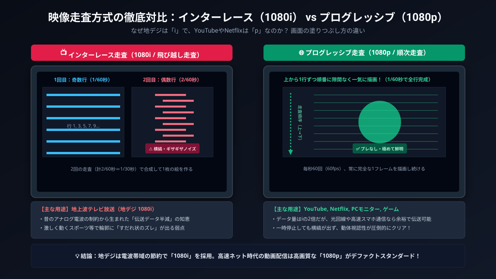
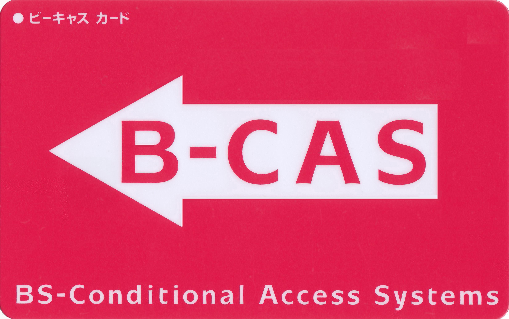
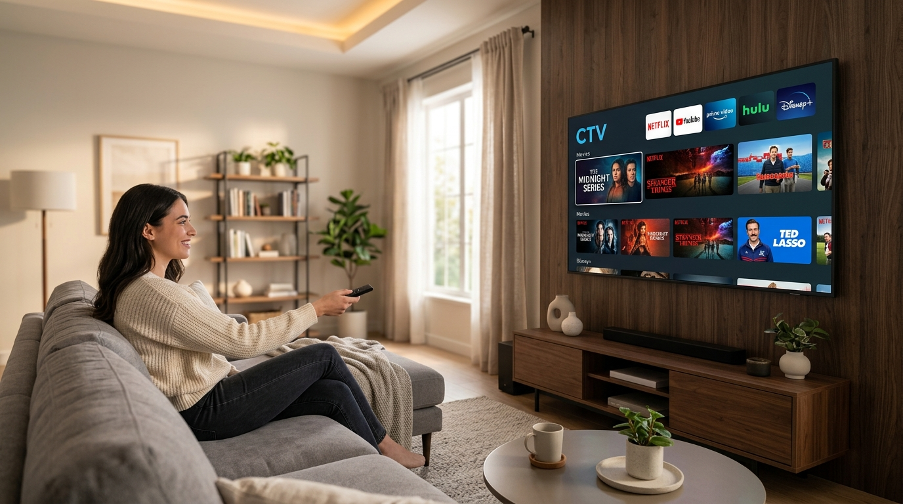

# テレビ放送とインターネット動画配信の未来

### 本日のアジェンダ

#### 🗺️ 全4テーマ

1. **映像のしくみ** —— 画素・解像度・走査方式・フレームレート
2. **映像端子と著作権保護** —— HDMI・HDCP・USB Type-C
3. **電波で届くテレビ放送** —— 地デジ・BS/CS・B-CAS・NHK ONE
4. **ネット動画配信と「テレビ」の変化** —— TVer・VOD・コネクテッドTV

---

### 到達目標

* 解像度（フルHD/4K/8K）と走査方式（インターレース／プログレッシブ）の違いを説明できる
* HDMIとHDCP、USB Type-Cで映像を出す仕組みを理解している
* 地デジと衛星放送（BS/CS）の違いと、CASによる視聴の制御を説明できる
* 動画配信のビジネスモデル（SVOD・AVOD・TVOD）を比較できる
* 放送とネットの融合で、テレビがどう変わりつつあるかを考察できる

---

### テレビをめぐる最近の動き（2025〜2026年）

| 時期 | 出来事 |
|:---|:---|
| 2025年4月 | **Amazon Prime Video**が広告を表示し始める（広告なしは月390円の追加料金） |
| 2025年10月 | NHKのネット配信が「必須業務」になり、**NHK ONE**が始まる。テレビがなくても、スマホだけで受信契約ができるようになった |
| 2026年3月 | **WBC**を**Netflixが日本で独占配信**。地上波での生中継なし |
| 2026年6〜7月 | サッカー**W杯**は**DAZNが全104試合**を配信。地上波で生中継されたのはNHK・日本テレビ・フジテレビの一部の試合だけ |
| 2026年9月 | 地方のテレビ局どうしが統合しやすくなる。同じ地域の2つの局を、1つの会社が持てるように（**1局2波**） |
| 2026年10月 | **TVer**の月間ユーザー数が**5,306万**で、過去最高 |
| 2027年1月（予定） | 民放5社が**BS4K放送を終了** |

* **「テレビ番組を見る」ことと「テレビ放送を受信する」ことが、別のことになりつつある。**

---

## 1. 映像のしくみ

### 考えてみたい問い

* テレビの「1080i」とYouTubeの「1080p」は何が違う？
* 昔のテレビ番組の左右に、黒い帯が出るのはなぜ？
* 地デジの映像を4Kテレビで見ても、粗く見えないのはなぜ？
* 映画（24fps）とゲーム（60〜120fps）で、1秒あたりのコマ数が違うのはなぜ？

---

### 画素（ピクセル）と解像度

* **画素（ピクセル）**：画面をつくる最小の点。赤・緑・青（**RGB**）の3つの光（サブピクセル）の明るさを変えて、色をつくる。

| 規格 | 横 × 縦 | 画素数 | 主な用途 |
|:---|:---|---:|:---|
| **SD** | 720 × 480 | 約35万 | DVD、アナログ放送 |
| **フルHD** | 1920 × 1080 | 約207万 | Blu-ray、配信（地デジの多くは1440 × 1080） |
| **4K** | 3840 × 2160 | 約829万（フルHDの4倍） | 4Kテレビ、配信、PS5 |
| **8K** | 7680 × 4320 | 約3,318万（フルHDの16倍） | NHK BS8K |

---

### アスペクト比 —— 4:3 → 16:9 → 9:16

* **アスペクト比**：画面の「横：縦」の比。

| 比率 | 時代 | 例 |
|:---|:---|:---|
| **4:3** | アナログ放送 | ブラウン管テレビ。今のテレビで見ると左右に黒い帯が出る |
| **16:9** | ハイビジョン・地デジ | 今のテレビとPCの標準。4:3と映画のスクリーンの中間の比率 |
| **9:16（縦長）** | スマホ動画 | TikTok、YouTubeショート、Instagramリール |

* 画面の形は、**その時代に主流の機器**に合わせて変わってきた。

---

### 走査 —— 画面を描く順番

* 画面は一度に全部光るのではなく、**左から右へ、上から下へ**、1行ずつ高速に描かれる（**走査**）。

| | インターレース（i：飛び越し走査） | プログレッシブ（p：順次走査） |
|:---|:---|:---|
| **描き方** | 奇数行と偶数行を交互に描く。2回で1枚 | 全部の行を順番に描く。1回で1枚 |
| **データ量** | 半分で済む | 多い |
| **弱点** | 動きの速い物や静止画で横縞が出る | 特になし |
| **使われ方** | **地デジ（1080i）**、昔のテレビ | **PC・スマホ・ネット配信（1080p）**、4K/8K放送 |

{fig-align="center" width="50%"}

---

### フレームレート（fps）—— 1秒に何枚の絵を見せるか

| fps | 用途 | 特徴 |
|:---|:---|:---|
| **24** | 映画 | 約100年続く標準。ほどよい残像が「映画らしさ」になる |
| **約30（60フィールド）** | 日本のテレビ放送 | インターレースで、1秒に60回半分ずつ描く |
| **60〜120以上** | ゲーム、スマホ | なめらかで、遅れが少ない。対戦ゲームでは有利 |

* ディスプレイが1秒間に画面を書き換える回数を**リフレッシュレート（Hz）**という。120Hzのスマホは、スクロールがなめらか。

---

### 超解像とフレーム補間 —— テレビの中の画像処理

* フルHDの映像を4Kテレビに映すには、画素を**4倍に増やす**必要がある。単純に引き伸ばすと、ぼやける。
* **超解像（アップコンバート）**：輪郭や質感から、足りない画素を推測して描き足す。最近はAIで学習した処理が主流。
* **フレーム補間（倍速駆動）**：コマとコマの間の絵をつくって差し込み、スポーツなどを滑らかに見せる。
* 映画では、補間で動きが滑らかになりすぎて不自然に見えることもある（「ソープオペラ効果」）。そのため、オフにできるテレビが多い。

---

## 2. 映像端子と著作権保護

### 考えてみたい問い

* 黄・白・赤の「ビデオ端子」は、なぜ消えたのか？
* 形は同じなのに、映像が映らないType-Cケーブルがあるのはなぜ？
* 「HDCP」とは何か？ なぜ機器をつなぐと画面が真っ暗になることがあるのか？

---

### アナログ端子からHDMIへ

| 端子 | 種類 | 送れるもの | その後 |
|:---|:---|:---|:---|
| **コンポジット（黄・白・赤）** | アナログ | SD映像＋音声 | 画質が低く、消えた |
| **D端子**（日本独自） | アナログ | ハイビジョン映像 | コピー防止の暗号をかけられない。著作権保護のため、ハイビジョンをアナログで出力することが禁止され、消えた |
| **VGA（D-Sub）** | アナログ | PCの映像 | 古いプロジェクターに残っている |
| **HDMI** | デジタル | 映像＋音声＋機器の制御 | **今の標準** |

* HDMIは、映像と音声を1本で送れる。テレビの電源を入れると、つないだ機器も一緒に起動する機能（**CEC**）もある。

---

### HDMIの世代

| 規格 | 帯域 | 主な対応 |
|:---|---:|:---|
| **HDMI 1.4**（2009年） | 10Gbps | フルHD、4K 30Hz |
| **HDMI 2.0**（2013年） | 18Gbps | 4K 60Hz |
| **HDMI 2.1**（2017年） | 48Gbps | 4K 120Hz、8K、可変リフレッシュレート（VRR）。PS5やゲーミングPCで使う |
| **HDMI 2.2**（2025年） | 96Gbps | 16K、4K 480Hz。2026年に対応ケーブル（**Ultra96**）が発売された |

* 端子の形が同じでも、**ケーブルや機器によって送れる映像が違う**。4K 120Hzには、「Ultra High Speed」と認証されたケーブルが必要。

---

### HDCP —— 画面が真っ暗になる理由

* **HDCP**：再生機器とディスプレイが互いに認証し、**暗号化した映像**を送る著作権保護の規格。4KにはHDCP 2.2以上が必要。
* 途中で映像を抜き取り、コピーできないようにしている。

```{mermaid}
flowchart LR
    A["🎮 再生機器<br/>PS5・レコーダー・PC"] <-->|"① 互いに認証"| B["📺 ディスプレイ"]
    A -->|"② 暗号化した映像"| B
    C["📼 HDCPに対応しない機器"] -.-x|"映らない"| A
    style C fill:#ffebee,stroke:#c62828
```

* **真っ暗になる例**：HDCPに対応しない古いモニタやプロジェクター、安い分配器、キャプチャ機器を挟んだとき。
* ゲーム実況の録画では、PS5の設定で**ゲーム画面のHDCPだけをオフ**にできる（動画配信アプリでは、オフにできない）。

---

### USB Type-C —— 同じ形でも、中身が違う

* **DisplayPort Alt Mode**：Type-C端子から映像信号を出す機能。ケーブル1本で、ノートPCの画面をモニタに映しながら**充電（USB PD）**もできる。
* 形は同じでも、ケーブルによってできることが違う。

| ケーブル | 充電 | データ転送 | 映像出力 |
|:---|:---:|:---:|:---:|
| 充電専用ケーブル | ⭕ | ❌ | ❌ |
| USB 2.0ケーブル（スマホ付属など） | ⭕ | 遅い（480Mbps） | ❌ |
| USB 3.x / USB4 / Thunderbolt 4・5 | ⭕ | 10〜80Gbps | ⭕ |

* 最近のケーブルには、**速度とワット数**（例：「40Gbps / 240W」）がロゴで表示されている。

---

## 3. 電波で届くテレビ放送

### 考えてみたい問い

* 2011年の「地デジ化」で、なぜ日本中のテレビを買い替えることになったのか？
* 「地上波」「BS」「CS」は何が違う？ パラボラアンテナはどこを向いている？
* テレビに挿さっていた「B-CASカード」はどこへ消えた？
* テレビがなくても、NHKの受信料を払うことがあるのはなぜ？

---

### 2011年 地デジ移行の理由 —— 電波を空ける

* **2011年7月24日**に、アナログ放送が終わった（岩手・宮城・福島は2012年3月）。
* デジタル化して映像を圧縮（MPEG-2）すると、**少ない電波で高画質に送れる**。
* 放送で使う周波数を詰めた結果、**700MHz帯**が空いた。2015年から、携帯電話（4G、今は5Gも）の**プラチナバンド**として使われている。
* つまり地デジ化は、**スマホのための電波を確保する**政策でもあった。

---

### 地上波・BS・CS の違い

| | 地上デジタル | BS（放送衛星） | CS（通信衛星） |
|:---|:---|:---|:---|
| **送信元** | 地上の電波塔（スカイツリーなど）と中継局 | 赤道上空約36,000kmの静止衛星（東経110度） | 静止衛星（東経110度・124/128度） |
| **アンテナ** | UHFアンテナ | パラボラアンテナ（南西の空に向ける） | パラボラアンテナ（110度ならBSと共用） |
| **範囲** | 地域ごと（県域・広域） | 全国一律 | 全国一律 |
| **料金** | 無料（NHKは受信料） | 多くは無料。一部有料（WOWOWなど） | 多くは有料（スカパー！など） |
| **弱点** | 山かげ・ビルかげ | 大雨で映らなくなる（降雨減衰） | 同左 |

---

### 放送と通信の決定的な違い

| | 放送（電波） | 通信（ネット配信） |
|:---|:---|:---|
| **届け方** | 1つの電波を、全員が同時に受信する | 視聴者ごとに、サーバーがデータを送る |
| **視聴者が増えると** | 何人増えても、コストは同じ | サーバーと回線の負担が増える。アクセスが集中すると止まることも |
| **遅延** | ほぼない | 数秒〜数十秒遅れる |
| **得意なこと** | 災害情報、大勢が同時に見る生中継 | 見たいときに見る、一人ひとりに合わせる |

* ネット配信は、視聴者の近くに置いたサーバー（**CDN**）から送ることで、集中に耐えている。

---

### B-CASカードとACAS

:::: {.columns}
::: {.column width="62%"}
* デジタル放送は**暗号化**されて送られている。B-CASカードの中の鍵で、暗号を解いて映す。
* 有料放送の契約や、録画のコピー制限を管理するのが役目（**CAS**：限定受信システム）。
* **2012年**、カードを書き換えて有料放送をタダで見る改造が広まった（BLACKCAS事件）。
* **ACAS**：2018年の4K8K放送の開始とともに登場した新方式。**テレビ本体に組み込まれたチップ**で、抜き差しも書き換えもできない。最近のテレビにはカードの挿し口がない。
:::
::: {.column width="38%"}

:::
::::

---

### 放送法の改正とNHK ONE

* **2025年10月**から、NHKのネット配信は放送の「補完」から**必須業務**になった。サービスはNHKプラスから**NHK ONE**へ。
* **テレビがなくても**、スマホやPCでNHK ONEを使うために受信契約をすれば、受信料（地上契約と同じ**月1,100円**）を払う。
* スマホを持っているだけ、アプリを入れただけでは、契約の義務は生じない。
* テレビで受信契約をしている人は、追加の料金なしで使える。
* 2026年3月末の利用アカウント数は**362万**。そのほとんどは、旧NHKプラスから移った人。

---

### 放送のこれから —— 電波を維持できるか

* **民放のBS4K撤退**：民放5社が、2027年1月でBS4K放送をやめる。4Kの視聴者が増えなかったことと、全国一律の放送では地域の広告が取りにくいことが理由。
* **中継局の維持費**：山間部などの小規模な中継局は、全世帯の3%弱しかカバーしていないのに、維持費が年に約80億円かかる。そこで、**光回線やネット配信で置き換える**ことが検討・実証されている。
* 4Kの番組は、電波よりも**ネット配信**で見るのが主流になりつつある。

::: {.callout-note title="考えてみよう"}
電波の放送がなくなり、すべてがネット配信になったら、何が困るだろうか？（災害時、アクセスの集中、通信料、高齢者）
:::

---

### ネットに移ると —— 地方局は何のためにある？

* 電波には届く範囲があるので、キー局の番組は**地方局の電波**を通して全国に届いてきた。
* ネットなら、キー局が全国に**直接**届けられる。TVerの同時配信に地域の制限があるのは、地方局を守るためでもある。
* 地方局の経営は厳しい。ローカル局114社の営業利益は、**2015年度の586億円から2024年度の251億円へ、6割近く減った**。
* **2026年9月**から、同じ地域の2つの局を1つの会社が持てるようになった（**1局2波**）。局どうしの統合を進めやすくするためだ。
* 系列の枠をこえた統合も進む。日本テレビ系の4局（札幌・中京・読売・福岡）は、2025年に**持株会社の下で1つのグループ**になった。

::: {.callout-note title="考えてみよう"}
全国の番組がネットで直接見られるとしたら、地方局にしかできないことは何だろうか？（ローカルニュース、災害情報、地元の広告）
:::

---

### ネットに移ると —— NHKの受信料はどうなる？

* 受信料は「**テレビを置いたら契約する**」というルールで集めている。見るかどうかは関係ない。
* ネットでは、ログインで**契約者だけに見せる**ことが簡単にできる。そこで「見たい人だけが払えばよい」（**スクランブル化**）という声がある。
* NHKは反対している（2026年6月にも会長が否定）。見たい人だけが払うと**契約者が減り**、公共放送を支えるお金が足りなくなるからだ。
* ところがスマホは、持っているだけでは契約の義務が生じない。テレビを持たない人が増えると、「テレビを置いたら」というルールそのものが成り立たなくなる。
* 海外では、仕組みを作り直した国がある。
    * **ドイツ**（2013年）：テレビの有無に関係なく、**全世帯から一律**に集める
    * **フランス**（2022年）：受信料を廃止して、**税金**でまかなう

::: {.callout-note title="考えてみよう"}
NHKのお金は、全員が払う・見たい人だけが払う・税金でまかなう、のどれがよいだろうか？
:::

---

## 4. ネット動画配信と「テレビ」の変化

### 考えてみたい問い

* テレビを持たない若者が増えているのはなぜ？
* Netflix、Prime Video、TVerは、どうやって利益を出している？
* 「テレビ放送が映らないテレビ」が売れるのはなぜ？
* WBCやW杯が、地上波で全試合見られなくなったのはなぜ？

---

### 若い人ほどテレビを見ない —— 数字で見る

:::: {.columns}
::: {.column width="58%"}
**平日1日の平均利用時間（2025年度）**

| 年代 | テレビ（リアルタイム） | ネット |
|:---|---:|---:|
| 10代 | 43分 | **228分** |
| 20代 | 46分 | **267分** |
| 40代 | 112分 | **229分** |
| 60代 | **249分** | 140分 |
| 70代 | **314分** | 94分 |
| 全年代 | 156分 | **184分** |

[総務省 情報通信政策研究所（2026年6月公表）]{style="font-size: 0.6em;"}
:::
::: {.column width="42%"}
**平日にテレビを15分以上見た人の割合**

| | 2020年 | 2025年 |
|:---|---:|---:|
| 16〜19歳 | 47% | **27%** |
| 20代 | 51% | **33%** |
| 全体 | 79% | **71%** |

[NHK放送文化研究所「国民生活時間調査」]{style="font-size: 0.6em;"}
:::
::::

* 20代は、テレビの**約6倍**の時間ネットを使う。テレビの方が長いのは60代以上だけ。
* 20代の**3人に2人**は、平日にテレビをほとんど見ない。

---

### 動画配信の3つのビジネスモデル

| モデル | 誰がお金を払う？ | 例 |
|:---|:---|:---|
| **SVOD**（定額見放題） | 利用者が毎月定額 | Netflix、Prime Video、Disney+、U-NEXT |
| **AVOD**（広告付き無料） | 広告主 | YouTube、TVer、ABEMA |
| **TVOD / PPV**（作品ごと・試合ごとに課金） | 利用者が1本ごと | 映画のレンタル、格闘技・ライブの有料配信 |

* **境目がなくなってきた**：Netflixは広告付きの安いプランをつくった（2022年）。Prime Videoは広告を入れ、広告なしを追加料金にした（2025年）。
* **FAST**：広告付きで、24時間番組を流し続ける無料の配信（ABEMAの各チャンネルなど）。ネットの中に「テレビ局」をつくる動き。

---

### TVer —— テレビ番組を、いつでもどこでも

* 2015年に、在京の民放5社が共同で始めた**見逃し配信**サービス（AVOD）。
* 放送後おおむね1週間、無料で見られる。2022年からは、ゴールデンタイムの番組を**放送と同時に配信**（サイマル配信）している。
* **月間ユーザー数**：5,306万（2026年10月、過去最高）。テレビの画面（コネクテッドTV）で見る人が特に増えている。
* テレビ局の評価軸も、世帯視聴率だけでなく、**個人視聴率・TVerの再生数**などを合わせて見る方向へ変わっている。

---

### スポーツ中継の地上波からの撤退

| 大会 | 日本での中継 |
|:---|:---|
| **2022年 サッカーW杯** | **ABEMA**が全64試合を無料で配信。地上波は一部の試合だけ |
| **ボクシング井上尚弥の試合** | **Prime Video**などの有料配信 |
| **2026年 WBC** | **Netflix**が全47試合を独占配信。地上波での生中継なし。日本のNetflixで史上最多の視聴を記録 |
| **2026年 サッカーW杯** | **DAZN**が全104試合を配信。地上波はNHK・日本テレビ・フジテレビの一部の試合だけ |

* **理由**：世界的な配信企業が参入し、**放映権料が高騰**した。テレビのCM収入では元が取れない。
* 配信企業にとっては、**会員を一気に増やせる**大きな機会になる。

---

### コネクテッドTVとチューナーレステレビ

* **コネクテッドTV**：ネットにつながったテレビ。YouTube、Netflix、TVerを、リビングの大画面でリモコンを使って見る。Fire TV Stickなどを後から挿しても同じことができる。
* **チューナーレステレビ**：地デジやBSのチューナーがなく、**ネット動画だけを見る**テレビ。
  * チューナーやB-CAS/ACASの部品が要らないので、**安い**。
  * 放送を受信できないので、**NHKの受信契約は不要**（ただし、NHK ONEを利用するために自分で契約すれば必要）。
  * 「地上波はリアルタイムで見ない」という一人暮らしに合う。

{fig-align="center" width="40%"}

---

### スマホの画面をテレビに映す —— ミラーリングとキャスト

| 方式 | 仕組み | 例 |
|:---|:---|:---|
| **ミラーリング** | スマホの画面を、そのままテレビに送る | AirPlay（Apple）、Miracast |
| **キャスト** | 「この動画を再生して」という指示だけを送る。テレビが自分で動画を受信する | Google Cast（Chromecast）、AirPlayの一部 |

* キャストではスマホは「リモコン」になる。画質が良く、スマホの電池も減りにくい。

---

### 実践チェック

1. **テレビの裏を見てみよう**：HDMI端子に「4K 120Hz」「eARC」などの表示はあるか？
2. **テレビの機能**：リモコンに、YouTube・Netflix・TVerのボタンはあるか？
3. **Type-C**：自分のノートPCやスマホのType-C端子は、映像を出力できるか？ 仕様表で確かめよう。
4. **自分の視聴**：この1週間で、地上波をリアルタイムで見た時間と、ネット動画を見た時間を比べてみよう。

---

### まとめ

1. **映像のしくみ**：画素・解像度、インターレースとプログレッシブ、フレームレート、超解像。
2. **端子と著作権保護**：HDMIの世代、HDCPによる暗号化、Type-Cは中身によってできることが違う。
3. **放送のしくみ**：地デジとBS/CS、CASによる暗号化。NHK ONEで、受信料が「テレビ」から離れ始めた。
4. **放送と配信の融合**：TVer、コネクテッドTV、スポーツの配信独占、BS4Kの撤退。「テレビ番組」は残るが、「電波で受けるテレビ」の役割は変わりつつある。

---

## Appendix

### 【図解】インターレースとプログレッシブ

```{mermaid}
flowchart TB
    subgraph I["📺 インターレース（1080i）"]
        direction LR
        I1["1回目<br/>奇数行（1, 3, 5…）"] --> I2["2回目<br/>偶数行（2, 4, 6…）"] --> I3["2回で1枚"]
    end
    subgraph P["💻 プログレッシブ（1080p）"]
        direction LR
        P1["全部の行<br/>（1, 2, 3, 4…）"] --> P2["1回で1枚"]
    end
    I ~~~ P
    style I fill:#fff3e0,stroke:#e65100
    style P fill:#e8f5e9,stroke:#2e7d32
```

---

### 【図解】放送とネット配信の届き方

```{mermaid}
flowchart TD
    subgraph B["📡 放送（1つの電波を全員が受信）"]
        T["🗼 電波塔"] -->|"UHF"| A1["🏠 UHFアンテナ"]
        S["🛰️ 静止衛星（東経110度）"] -->|"12GHz帯"| A2["📡 パラボラアンテナ"]
    end
    subgraph N["🌐 ネット配信（視聴者ごとに送信）"]
        O["🏢 配信元"] --> C["⚡ CDN（視聴者の近くのサーバー）"]
        C -->|"光回線・5G"| D["📱 スマホ・コネクテッドTV"]
    end
    style B fill:#e1f5fe,stroke:#0288d1
    style N fill:#e8f5e9,stroke:#2e7d32
```

---

### 【図解】動画配信のお金の流れ

```{mermaid}
flowchart LR
    subgraph SV["🎬 SVOD"]
        U1["利用者"] -->|"月額料金"| P1["Netflixなど"]
    end
    subgraph AV["📢 AVOD"]
        S2["広告主"] -->|"広告料"| P2["TVer・YouTubeなど"]
        P2 -->|"無料の番組＋CM"| U2["利用者"]
    end
    subgraph TV["🎟️ TVOD / PPV"]
        U3["利用者"] -->|"1本・1試合ごと"| P3["レンタル・有料ライブ"]
    end
    style SV fill:#e1f5fe,stroke:#0288d1
    style AV fill:#fff8e1,stroke:#ffa000
    style TV fill:#ede7f6,stroke:#512da8
```
