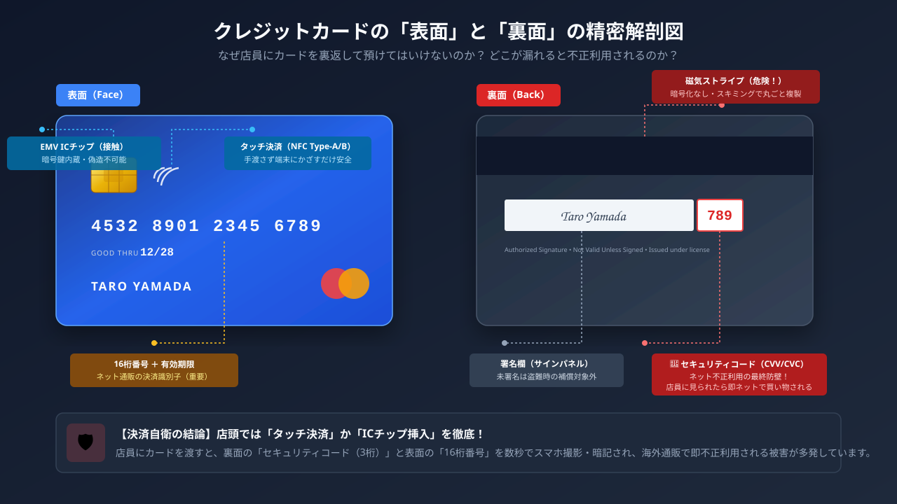
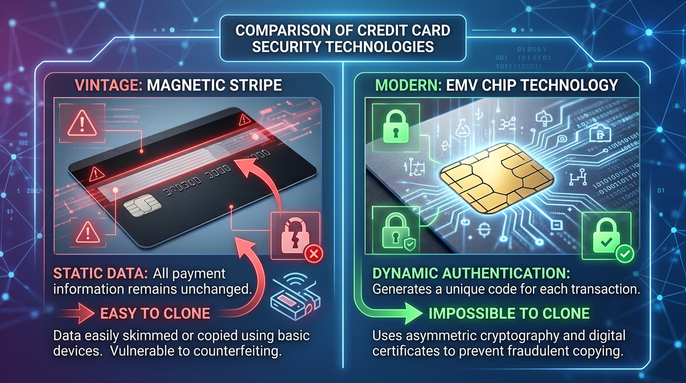

# なりすましを防ぐ技術とデジタル身分証

### 本日の講義マップ —— アジェンダ

1. **ネットショッピングで不正利用されないために**
2. **マイナンバーカードと身分証の一体化**

---

### 本日の到達目標 —— 「本人であること」をどう証明するか

* クレカのICチップとApple Payのトークン化が、なりすましをどう防ぐか説明できる
* 3Dセキュアなど、ネット決済での本人確認の仕組みを理解する
* マイナンバーカードのICチップ構造と分散管理の安全性を把握する
* キャッシュレスと身分証の仕組みを踏まえた「デジタル身だしなみ」を身につける

---

## 1. ネットショッピングで不正利用されないために

### 考えてみたい問い

* クレカの番号と裏の3桁を知られると、なぜ他人でも買い物ができてしまう？
* 公式の通販サイトなのに、カード番号が盗まれることがあるのはなぜ？
* Apple Payで支払うと、なぜカード番号がお店に盗まれない？

---

### そもそもクレジットカードは「なぜネットで危険」なのか？

#### 🏛️ 60年前に作られた「性善説」の仕組み

* クレジットカードは、もともと「対面店舗で店員にカードを渡し、サイン（署名）して使う紙伝票時代」に作られた古い仕組み。
* 券面に印刷されている**「16桁の番号・有効期限・裏の3桁（セキュリティコード）」**の3つさえ知っていれば、**持ち主本人でなくても世界中のネット通販で買い物ができてしまう！**
* つまり、「鍵と暗証番号が表面にデカデカと刻印された金庫」を持ち歩いているような危うさを持っています。

---

### 【図解】クレジットカードの表面と裏面の精密解剖図

{fig-align="center" width="65%"}

---

### クレジットカード取扱いの鉄則：裏面コードの死守

* **券面に記された情報の危険性**：
  * 「16桁のカード番号・有効期限・裏面3桁（CVV/セキュリティコード）」の3点が揃えば、誰でもネットショッピングが可能。
* **店頭での自衛ポイント**：
  * 店員にカードを手渡して裏返されないようにする（スマホで撮影・暗記される不正が多発）。
  * 店頭では可能な限り「タッチ決済」か「自分で端末に差し込む」運用を徹底する。

---

### 黒い磁気テープから「金色のICチップ」へ —— スキミング撲滅の歴史

#### 💳 かつての恐怖：磁気ストライプ（裏面の黒い帯）

* 昔のクレジットカードは、裏面の黒い磁気帯にカード番号が平文のまま記録されていた。
* 「スキマー」という小型リーダーにカードを一瞬通すだけで**データが丸ごと盗まれ（スキミング）、偽造クローンカードが世界中で大量生産**された！
* **救世主：金色の「接触ICチップ」（EMV規格）の誕生**：
  * チップの中身は極小のマイクロコンピュータ。
  * 暗号鍵がチップ内部の超高セキュリティ領域に封印されており、**外部から物理的・電気的に中身をコピーすることは不可能**！

---

### 【比較】磁気ストライプ vs 接触ICチップのセキュリティ

{fig-align="center" width="60%"}

::: {.callout-note title="静的データから動的認証へ"}
磁気テープは「何度読んでも同じ静的データ」が出るため複製が容易でした。ICチップは「毎回異なる暗号トークンを生成する動的認証」のためクローンカードが作れません。
:::

---

### なぜICチップだと偽造できないのか？ —— 「動的暗号認証」

#### 🔐 毎回変わる「1回限りの暗号署名」

* **磁気ストライプ（静的データ）**：何度スワイプしても同じデータが出る → コピーされたら一発アウト。
* **ICチップ（動的暗号処理 / チャレンジ・レスポンス）**：
  * レジ端末に差し込むと、端末から毎回ランダムな暗号問題（乱数）が出題される。
  * ICチップが内部の秘密鍵で一瞬で計算し、**「その決済1回だけ有効な暗号署名（トークン）」**を返答！
  * 暗証番号（PIN）の照合もICチップ内部で安全に実行。
* **そして犯罪の戦場は「対面」から「ネット」へ**：
  * 実店舗での偽造が完全に封じられたため、犯罪者たちは**「ICチップの暗号通信が使えず、番号を手入力させるネット通販」**へと標的を一斉にシフトした！

---

### クレカ番号をネットで入力するリスクと現代の対策

#### 🚨 番号を直接サイトに渡す危険性

* 怪しい通販サイトやフィッシング詐欺に一度でもカード番号を入力すると、その瞬間に情報が抜き取られる。
* 信頼できる大手通販サイトであっても、そのサイトがハッキングされれば**数百万人分のカード番号が一斉流出**して世界中で不正利用される！

::: {.callout-important title="この弱点を克服する現代のテクノロジー"}
「本物のカード番号を相手に渡さずに決済する」ために発明されたのが、次に学ぶ**Apple Payの「トークナイゼーション」**や、SMS認証を挟む**「3Dセキュア」**です！
:::

---

### 公式サイトでも盗まれる！「フォームジャッキング」の罠

#### 💉 正規の決済画面に悪意あるコードを仕込む手口

* **フィッシングとの違い**：
  * フィッシングは「偽サイトへ誘導」する手口。
  * フォームジャッキングは、**「本物の公式通販サイト」が改ざんされ、決済入力フォームに不正なJavaScriptを埋め込まれる！**
* **なぜ見抜けないのか？**：
  * URLも本物、暗号化（https / 鍵マーク）も正常、商品も届く。
  * しかしカード番号を入力した瞬間、**裏で犯人のサーバーへ番号とセキュリティコードが密かに送信**される！
* **対抗策**：
  * ユーザー側で画面を見て防ぐのは不可能。
  * だからこそ、次に学ぶ**「カード番号をフォームに直接入力しないApple Pay」**や**「3Dセキュア」**が必須の自衛策になります！

---

### Apple Pay / Google Pay の神機能「トークナイゼーション」

前回見たとおり、Apple Payはカードを入れる「財布」。では、支払いのときにカード番号はお店に渡るのか？

* **本物の番号を隠す技術**
  * 本物の16桁カード番号（PAN）は隔離保管。
  * 代わりに使い捨て代理番号（トークン / DPAN）で決済。
  * お店からトークンが盗まれても、**スマホの生体認証の署名がないと使えない**ため犯人は悪用不可！

---

### 【たとえ話】🪙 ゲームセンターのメダルでたとえると？

::: {.callout-tip title="🪙 ゲームセンターのメダルでたとえると？"}
本物の1万円札をお店に渡すのではなく、**「その場所だけで使える使い捨てメダル」**に変えて遊ぶようなものです。メダルを落としても本物の財布（1万円札）は安全！
:::

---

### 【図解】Apple Payのトークン決済シーケンス

```{mermaid}
sequenceDiagram
    autonumber
    participant U as "ユーザー (iPhone)"
    participant S as "ネットショップ"
    participant N as "カード会社"
    U->>S: Apple Payで支払い (トークン送信)
    Note over S: 本物のカード番号は<br/>ショップに一切伝わらない！
    S->>N: トークンを照会
    N-->>S: 決済承認 ✅
```

* **安全性の本質**：ショップ側に本物のカード番号が一切渡らないため、店舗サーバーが情報漏洩を起こしても不正利用のリスクがありません。

---

### iPhoneの安全性を支える心臓部「Secure Element（金庫チップ）」

#### 🛡️ iOSやアプリから物理的に隔離された超安全地帯

* iPhoneの中には、通常のアプリやiOSメインシステムから**物理的にアクセスできないセキュリティ専用チップ「Secure Element」**が搭載されている。
* カードの代理番号（トークン）や秘密鍵はここに隔離保管され、iPhoneがウイルス感染しても絶対に盗まれない！
* サイドボタンのダブルクリック＋Face ID/Touch ID認証が成功した瞬間だけ、1回限りの使い捨て暗号署名を発行。

---

### 【図解】iPhone内のSecure Element（隔離金庫）と生体認証

```{mermaid}
flowchart TD
    subgraph iPhone["📱 iPhone本体"]
        iOS["iOS システム & 各種アプリ"] -.->|"物理的にアクセス不可 🚫"| SE
        subgraph SE["🔐 Secure Element (隔離された金庫チップ)"]
            DAN["代理カード番号 (トークン)"]
            Key["秘密暗号鍵"]
        end
        Bio["👁️ Face ID / Touch ID (生体認証)"] -->|"本人確認成功で扉開放 ✅"| SE
    end
    SE -->|"使い捨て暗号署名のみ送信"| Terminal["🏪 店舗レジ / ネット決済"]
    
    style SE fill:#ede7f6,stroke:#512da8,stroke-width:2px
    style iPhone fill:#f5f5f5,stroke:#9e9e9e
    style Terminal fill:#e1f5fe,stroke:#0288d1
```

---

### 「財布を落とす」より「iPhoneを落とす」方が安全な理由

#### 🚨 紛失時のリスク比較

| 紛失したもの | 不正利用のリスク | 紛失時の対処法 |
|:---|:---|:---|
| **プラスチックの財布** | サインやタッチ決済で**すぐに不正利用される危険**大 | 全てのカード会社に1社ずつ電話して利用停止（大変！） |
| **iPhone (Apple Pay)** | 他人はFace ID/パスコードを解錠できず**1円も使えない** | PC等の**「探す」アプリで一瞬でカード全停止＆初期化**！ |

::: {.callout-note title="💡 物理カード以上の安全性"}
iPhoneを落としても、本物のカード番号は本体に保存されておらず、生体認証なしでは決済できないため、物理的な財布を持ち歩くよりはるかに安全です。
:::

---

### 3Dセキュア 2.0 —— 買い物の最後に飛んでくる画面

#### 🛡️ AIによる「リスクベース認証」

* **低リスク判定（いつものスマホ、いつもの配送先、通常時間帯）**：
  追加のパスワード入力なしで一瞬で決済完了（フリクションレス・フロー）。全体の9割以上はこれ！

* **高リスク判定（深夜の初見高額品、海外IP、不審な端末環境）**：
  怪しいとAIが判断した時だけ、ワンタイムパスワードやスマホの生体認証（チャレンジ・フロー）を発動！

---

### 【図解】3Dセキュア2.0 リスクベース認証フロー

```{mermaid}
flowchart TD
    Pay["💳 ネットショップでクレカ決済ボタン押下"] --> Check{"🤖 カード会社のAIリスク判定エンジン<br/>（端末情報・IP・購入金額・行動履歴を総合分析）"}
    Check -->|低リスク（通常の安全な決済）| Pass["✅ 即座に決済承認（パスワード入力不要！）"]
    Check -->|高リスク（不正利用の疑いあり）| Challenge["⚠️ 追加認証（チャレンジ）を発動"]
    Challenge --> OTP["📱 SMSワンタイムコード / 銀行アプリ生体認証"]
    OTP -->|認証成功| Pass
    OTP -->|認証失敗 / 放置| Reject["❌ 決済遮断（不正利用を未然防止）"]
    style Pass fill:#e8f5e9,stroke:#2e7d32
    style Challenge fill:#fff3e0,stroke:#f57c00
    style Reject fill:#ffebee,stroke:#c62828
```

---

## 2. マイナンバーカードと身分証の一体化

### 考えてみたい問い

* 「マイナンバーを知られたら全財産が抜かれる」は本当？
* 券面に印刷された番号とICチップの中身は何が違う？
* お酒を買う時、なぜ年齢だけでなく本名や住所まで店員に見せてしまう？

---

### マイナンバーカードの誤解 —— 「一元管理で漏れる」の嘘

#### ❌ よくある都市伝説
「国が一箇所のスパコンで全国民の病歴・年金・預金を一元監視している」

---

### ⭕ 実際の仕組み —— 安全な「分散管理」ネットワーク

#### ⭕ 実際の仕組み：分散管理

* 税務署は税金、病院はカルテ、市役所は住民票と、**データは別々のサーバーでバラバラに管理**。
* 暗号化された別々の「符号」で照会するため、1箇所が漏れても芋づる式に盗まれない！

---

### 【図解】省庁・自治体の分散管理ネットワーク
```{mermaid}
flowchart TD
    subgraph Isolated["分散管理システム"]
        Tax[("国税庁: 税務データ")] 
        Pension[("年金機構: 年金データ")]
        City[("自治体: 住民票データ")]
    end
    Bridge["情報連携ネットワーク<br/>(暗号化符号で中継)"]
    Tax <--> Bridge
    Pension <--> Bridge
    City <--> Bridge
    style Bridge fill:#e0f2f1,stroke:#00796b
```

---

### 表面の番号と、ICチップの決定的な違い

* **券面の12桁の番号**
  * 法律で定められた手続きでのみ使う単なる「整理番号」。番号を知られただけで預金は下ろせない。
* **本体はICチップ内の「電子証明書」**
  * 署名用電子証明書（英数字6〜16桁）：デジタル実印。
  * 利用者証明用電子証明書（数字4桁）：印鑑証明。

---

### 【たとえ話】🪪 社員証と実印でたとえると？

::: {.callout-tip title="🪪 社員証と実印でたとえると？"}

* **券面の番号**：社員証に印刷された「社員番号」。見られても悪用はできない。
* **ICチップ**：金庫に入った「実印」。暗証番号という鍵を開けない限り、誰も押すことができない！
:::

::: {.callout-important title="🚨 暗証番号ロック"}
数字4桁は3回、英数字は5回間違えると自動ロックされます。
:::

---

### なぜ同じ4桁を何度も書く？ —— 「4つの暗証番号」の役割分担

#### 🪪 役所の窓口で設定させられる4つの暗証番号の謎
| 暗証番号の種類 | 桁数 | ロック条件 | 主な使い道（役割） |
|:---|:---|:---|:---|
| **1. 署名用電子証明書** | **英数字6〜16桁** | **5回連続ミス** | インターネット上の**「デジタル実印」**（確定申告の送信等） |
| **2. 利用者証明用** | 数字4桁 | 3回連続ミス | インターネット上の**「印鑑証明」**（マイナポータルログイン等） |
| **3. 券面事項入力補助用** | 数字4桁 | 3回連続ミス | チップから**氏名・住所・生年月日を自動読取**する鍵 |
| **4. 住民基本台帳用** | 数字4桁 | 3回連続ミス | 役所の窓口端末で**住基ネットデータを更新**する鍵 |

::: {.callout-tip title="💡 実は2・3・4は同じ数字でOK！"}
4桁の3種類は別々に設定することもできますが、混乱を防ぐため**同じ4桁を共通設定している人がほとんど**です。実質的には「4桁の合言葉」と「大人の実印（英数字6〜16桁）」の2つを管理すればOK！
:::

---

### 運転免許証・保険証の一体化と紛失時のリスク管理

#### 🪪 1枚に集約される便利さと、落とした時の安全設計

* **一体化のメリット**：
  * 財布が薄くなる、住所変更時に警察署と役所の両方に行く手間が激減、医療情報の正確な共有（おくすり手帳連携）。
* **落としたら全てを失う？（紛失時のリスク管理）**：
  * **24時間365日の利用停止コールセンター**（即座に一時停止）。
  * カード自体には病歴や口座残高は記録されておらず、暗証番号がなければICチップは読み取れない。
  * 顔写真付きのため、他人が拾ってもなりすまし対面利用は不可能！

---

### 年齢確認で住所まで晒す罠 —— 免許証提示の過剰開示問題

#### 🪪 免許証提示の「過剰開示問題」

* コンビニでお酒や煙草を買う際、運転免許証を見せると「20歳以上か」だけでなく、**本名・生年月日・自宅住所・顔写真まで店員に丸見え**になる。
* 本来必要な情報は「20歳以上か否か（True / False）」の1点だけ！

---

### ゼロ知識証明（ZKP）の革命 —— 秘密を明かさずに証明する

#### 🔐 ゼロ知識証明（Zero-Knowledge Proof）の威力

* 「生年月日」や「住所」の生データを1文字も相手に渡すことなく、**「私は20歳以上の条件を満たしている」という数学的暗号証明だけを送信**する先端暗号技術。
* 相手には「条件を満たしている事実」だけが伝わり、生データは一切漏洩しません（デジタル身分証時代の究極のプライバシー保護）。

---

### 【図解】ゼロ知識証明（ZKP）によるプライバシー保護年齢確認フロー

```{mermaid}
flowchart LR
    A["📱 あなたのスマホ<br/>（マイナンバーカード内蔵）"] -->|「20歳以上である」という<br/>暗号ハッシュ証明のみ送信| B["📟 店舗リーダー端末<br/>（生年月日・住所・本名は非表示！）"]
    B -->|証明の正当性を数学的に検証| C["✅ 年齢確認クリア（販売許可）"]
    style A fill:#ede7f6,stroke:#512da8,stroke-width:2px
    style B fill:#e1f5fe,stroke:#0288d1
    style C fill:#e8f5e9,stroke:#2e7d32
```

---

### マイナポータルで「できること」（役所に行かないデジタル行政）

#### 🏛️ 窓口に並ばずスマホで完結する行政手続き

* **確定申告（e-Tax）連携**：医療費控除やふるさと納税、年金データを自動連携して一括入力。
* **パスポートの更新申請**：写真撮影から申請までオンライン化（窓口へ行くのは受取時の1回だけ）。
* **引越しワンストップサービス**：転出届を役所窓口に行かずにオンライン提出。
* **医療・健康データの確認**：処方された薬の履歴や健診結果を自分でいつでも一元確認可能。

::: {.callout-note title="💡 「こういうことができる」と知っておく"}
「すべて役所の窓口や書類で手続きするもの」という固定観念をなくし、「スマホで安全に完結できる手続きが増えている」と知っておくことがデジタル教養の第一歩です。
:::

---

### 進化するマイナポータル ① UI/UXの大幅リニューアル

#### 🔄 デジタル庁による導線・デザイン刷新

* **使いづらさの改善**：画面デザイン・導線が大幅にリニューアルされ、目的の手続きを探しやすい「手続きナビ」やシンプルなUIへと進化。
* よく使う手続きをお気に入り登録したり、年金・税金の通知をアプリ内で一括確認できるよう改善が進んでいます。

---

### 進化するマイナポータル ② スマホ搭載と生体認証ログイン

#### 📱 「カードを毎回かざす」から「生体認証」へ

* これまでは手続きのたびに物理カードをスマホ裏面にかざし、暗証番号を入力する必要があった。
* **Androidに続き、iPhoneへの「スマホ用電子証明書」搭載**が順次進展。
* 物理カードを取り出さなくても、**スマホのFace ID / Touch ID（生体認証）だけで安全・瞬時にログインできる時代**へ移行しています！

---

### 総括：ブラックボックスを開ける知性

#### 🔍 ブラックボックスを開ける知性

* スマホの薄いガラスの向こう側では、暗号理論、分散システム、通信規約、法律がミリ秒単位で動いています。
* 単に流される受動的な消費者から、仕組みを理解するデジタル市民へ。

---

### 🏛️ デジタル社会を生き抜く3原則

#### 🏛️ デジタル社会を生きる3原則

1. **仕組みを知る**：裏側でどんなデータが動いているか想像する。
2. **過信しない**：便利さの裏には必ず落とし穴がある。
3. **自衛を行動に移す**：パスキー、MFA、アップデートを自らコントロールする。

---

### 【修了チェック】あなたのデジタル身だしなみテスト

#### 📝 10点満点で何点取れる？

* [ ] 1. 主要アカウントのパスワードを使い回していない
* [ ] 2. 重要なサービスで2要素認証を有効にし、バックアップコードを控えている
* [ ] 3. スマホの「盗難デバイスの保護」やOSアップデートを怠っていない
* [ ] 4. 公衆Wi-Fiで暗号化されていないサイトに個人情報を入れない
* [ ] 5. 怪しい警告画面の電話番号に連絡せず、ブラウザのタブを閉じる
* [ ] 6. SNSの甘い儲け話（闇バイト・名義貸し・投資勧誘）を100%無視できる
* [ ] 7. クレカの明細を確認し、「リボ払い」や不要なサブスクがないか把握している
* [ ] 8. アプリの位置情報・写真権限を絞り、写真のExif流出に配慮している
* [ ] 9. 無料マンガサイトやトレントなどの違法配信に手を出さない
* [ ] 10. 生成AIに機密情報や他人の個人情報を入力しない
