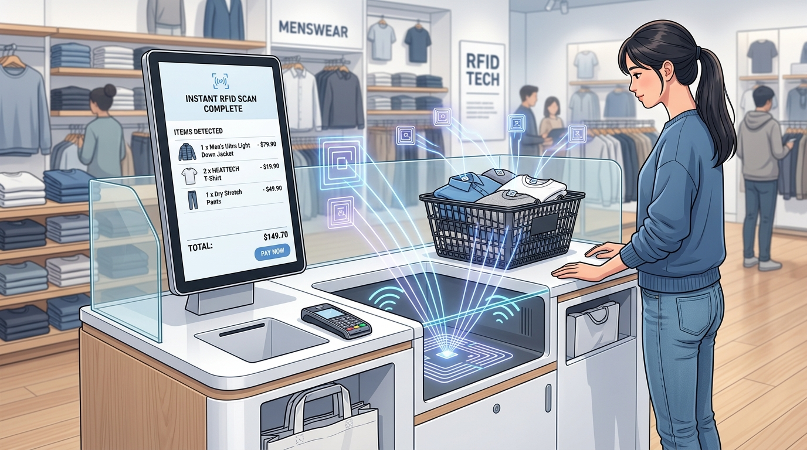
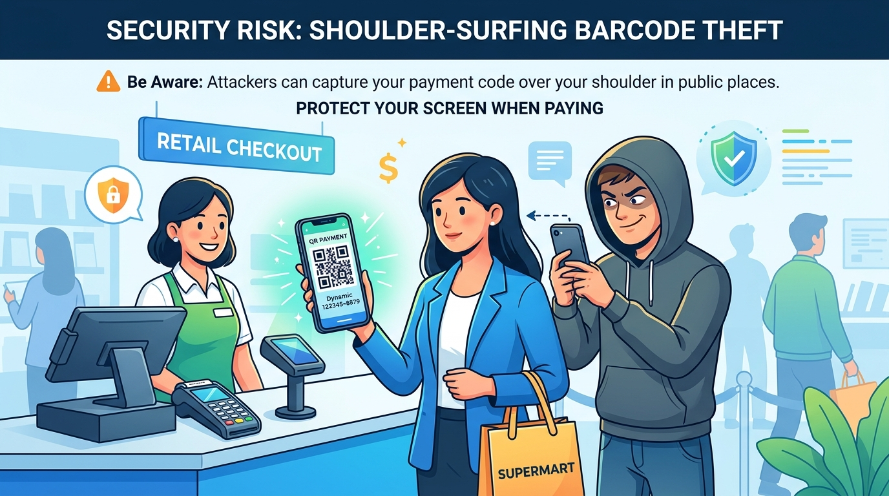

# キャッシュレス決済のしくみとお金の使い方

### 本日のアジェンダ

#### 🗺️ 全2テーマ

1. **かざす決済とQRコード** —— 支払い方の種類と、その仕組み
2. **キャッシュレスの種類と後払いの落とし穴** —— 前払い・即時払い・後払い

---

### 到達目標

* かざす決済とコード決済の種類と、お金の記録がどこにあるかの違いを説明できる
* 前払い・即時払い・後払いの違いと、Apple Payの位置づけを説明できる
* リボ払い・BNPL・サブスクのリスクを理解している

---

### 日本のキャッシュレスの現状

* 2025年のキャッシュレス決済の比率は**58.0%**（経済産業省の新しい国内指標。国際比較用の指標では46.3%）。政府は2030年に65%を目指している。

| 種類 | 金額の割合 | 回数の割合 |
|:---|---:|---:|
| クレジットカード | **82.7%** | 52% |
| コード決済（QR） | 10.2% | **31%** |
| 電子マネー | 3.7% | 13% |
| デビットカード | 3.4% | 3% |

* 金額ではクレジットカードが圧倒的。回数では、少額の支払いに使われるコード決済が伸びている。

---

## 1. かざす決済とQRコード

### 支払い方の種類

| | かざす決済（日本式：FeliCa） | かざす決済（世界標準：NFC） | コード決済（QR・バーコード） |
|:---|:---|:---|:---|
| **例** | Suica、PASMO、iD、QUICPay | クレカのタッチ決済 | PayPay、楽天ペイ、d払い |
| **速さ** | 約0.1秒 | 0.3〜1秒 | 数秒 |
| **お店の負担** | 高い（専用の端末） | 中くらい（世界共通の端末） | ほぼゼロ（QRを置くだけ） |
| **特徴** | 改札に強い | 海外のカードも使える | ポイント還元が多い |

---

### いちばん大きな違い —— お金の記録はどこにある？

| | お金の記録の場所 | 通信 | その結果 |
|:---|:---|:---|:---|
| **Suicaなどの交通系IC** | **カードの中**のICチップ | いらない | 0.1秒で終わる。電波がなくても使える |
| **コード決済（PayPayなど）** | **会社のサーバー** | スマホの通信が必要 | 数秒かかる。電波が弱いと使いにくい |
| **クレジットカード（タッチ決済も）** | **カード会社のサーバー** | お店の端末が通信して確認 | 使った分を翌月にまとめて請求 |

* 速さや使える場面の違いは、ほとんどが「記録がどこにあるか」で説明できる。

---

### 電池がないのに、なぜカードが動くのか？ —— 電磁誘導

* 改札機は、いつも弱い磁界を出している。
* カードのコイルが磁界を通ると、**電気が生まれる**（電磁誘導）。
* その電気でICチップが一瞬だけ動き、通信する。
* スマホの置くだけ充電やIH調理器と同じ原理。

```{mermaid}
flowchart LR
    A["📶 改札機<br/>磁界を出す"] --> B["🌀 カードのコイル<br/>電気が生まれる"] --> C["⚡ ICチップ<br/>一瞬起動して通信"]
```

---

### 電波で読み取る技術 —— RFIDとNFC {.nostretch}

| | RFID（UHF帯） | NFC（FeliCaもこの仲間） |
|:---|:---|:---|
| **距離** | 数メートル | 10cm以内 |
| **得意なこと** | たくさんの物を一度に読む | 1対1で確実に読む |
| **例** | ユニクロのセルフレジ、物流 | Suica、クレカ、マイナンバーカード |

* 決済の電波が数メートル飛んだら、隣の人のカードから引き落とされてしまう。だから決済は**近距離のNFC**。

{fig-align="center" width="35%"}

---

### Suicaはなぜ0.1秒で通れるのか？

* 通勤ラッシュでは、1台の改札を**1分に約60人**が通る。立ち止まらずに通すには、約0.1秒で処理を終える必要がある。
* 0.1秒の間に行うこと：
  * カードを見つける → 暗号で本物か確かめる → 運賃を計算する → **カードの残高を書き換える** → 扉を開く
* 残高は**カードの中**にあるので、サーバーとの通信を待たずに済む。

---

### 改札の2つの方式 —— Suicaとクレカのタッチ乗車

| | Suica方式 | クレカのタッチ乗車（ABT方式） |
|:---|:---|:---|
| **仕組み** | カードのICに残高を書き込む | カードのIDだけ読み、運賃は後でクラウドで計算 |
| **速さ** | 約0.1秒 | 約0.3〜0.5秒 |
| **支払い** | 事前にチャージ | 後払い（翌月のクレカ請求） |
| **改札機** | 高機能で高価 | 安い汎用の端末で済む |
| **向いている場面** | 通勤ラッシュ・定期券 | 旅行・訪日客・地方の路線 |

* 訪日客が自分の国のカードで乗れ、地方の鉄道は設備費を抑えられるので、急速に広がっている。
* 「通勤はSuica、旅行はクレカ」という**使い分け**が進む。

---

### QRコード —— 日本生まれの世界標準

* **1994年、デンソー**（トヨタ系の部品メーカー）の原昌宏氏が開発。囲碁の盤面から発想した。
* 特許を持ちながら使用料を取らなかったため、世界中で使われるようになった。

| 強み | 内容 |
|:---|:---|
| **大容量** | 数字なら約7,000文字（バーコードは約20文字） |
| **どの向きでも読める** | 3つの角の四角で、向きと位置を見つける |
| **汚れに強い** | 最大30%が欠けても読める |
| **漢字が入る** | 最初から日本語を想定して設計 |

---

### QRコードの使い道 —— 匿名配送

* 決済、荷物の追跡、チケット、飛行機の搭乗券など、あらゆる場面で使われる。
* **匿名配送**（メルカリなど）：伝票に住所を書かず、QRコードで発送する。住所は配送会社のシステムの中だけで照合されるので、**出品者と購入者が互いの住所を知らずに**取引できる。

```{mermaid}
flowchart LR
    A["👤 出品者"] -->|QRコードで発送| B["🏪 コンビニ・営業所<br/>住所のない伝票"]
    B --> C["🚚 配送会社<br/>システム内で宛先を照合"]
    C --> D["🏠 購入者"]
```

---

### コード決済の2つの方式と、狙われ方 {.nostretch}

| 方式 | 仕組み | 狙われ方 | 対策 |
|:---|:---|:---|:---|
| **利用者が見せる** | 自分のスマホのバーコードを、お店が読む | 列の後ろから画面を盗撮される | 支払いの直前まで画面を開かない |
| **お店が見せる** | お店のQRを、自分のスマホで読む | お店のQRの上に、犯人のQRシールを貼られる | お店はQRを固定し、毎日確認する |

{fig-align="center" width="50%"}

---

### 個人間送金の落とし穴

* PayPayの残高には2種類ある。
  * **PayPayマネー**（本人確認済み）：銀行口座に出金できる。
  * **PayPayマネーライト**：買い物と送金だけ。出金できない。
* **送金詐欺**：「チケットを譲ります。先にPayPayで送って」と言い、受け取ったら連絡を絶つ。
* 個人間の送金は、銀行振込と同じく**原則として取り消せない**。

---

## 2. キャッシュレスの種類と後払いの落とし穴

### キャッシュレスの3類型 —— いつお金が引き落とされるか

| 類型 | 引き落とし | 例 | 注意点 |
|:---|:---|:---|:---|
| **前払い（プリペイド）** | 使う**前**にチャージ | Suica、nanaco、WAON、PayPay残高 | 使いすぎにくいが、チャージの手間がある |
| **即時払い（デビット）** | 使った**瞬間**に口座から | デビットカード | 口座の残高までしか使えない |
| **後払い（ポストペイ）** | **翌月**にまとめて | クレジットカード、iD、QUICPay | 手元にお金がなくても使える。使いすぎに注意 |

---

### 電子マネーの系統

| 系統 | 例 | 支払い方 | 特徴 |
|:---|:---|:---|:---|
| **交通系** | Suica、PASMO、ICOCA | 前払い | 改札を0.1秒で通れる |
| **流通系** | nanaco、WAON、楽天Edy | 前払い | 系列店でポイントが多い |
| **クレジット系** | iD、QUICPay | 後払い | チャージ不要 |

* iDやQUICPayは、**クレジットカードの後払いを、かざして使えるようにしたもの**。残高はない。

---

### Apple Pay —— 電子マネーではなく「財布」

* Apple Pay（Google Payも同じ）は、クレジットカードやSuicaをスマホに入れる**デジタルな財布**。
* お店では「Apple Payで」ではなく、中のカードに合わせて「Suicaで」「iDで」「QUICPayで」と伝える。
* スマホにクレカを入れると、iDやQUICPayとして使えるようになる。
* **Suicaだけは特別**：顔認証なしで改札を通れる（エクスプレスカード）。電池が切れても、数時間は改札を通れる。

---

### 後払いの落とし穴 ① リボ払い

:::: {.columns}
::: {.column width="55%"}
* 毎月の支払額が一定になる払い方。金利は**年15%前後**と高い。
* 残高30万円を月1万円ずつ返すと、1万円のうち**約3,750円が利息**に消える。
* 支払いは**一括払い**が基本。自動でリボ払いになる設定になっていないか確認する。
:::
::: {.column width="45%"}
```{mermaid}
pie title 返済1万円の内訳
    "元本の返済" : 62.5
    "利息" : 37.5
```
:::
::::

---

### 後払いの落とし穴 ② BNPLとサブスク

| | 何が起きるか | 対策 |
|:---|:---|:---|
| **BNPL（あと払いサービス）** | 電話番号とメールだけで後払いできる。滞納すると**信用情報に傷がつく**ことがあり、5年ほどクレカやローンの審査に通りにくくなる | 少額でも期日に払う |
| **サブスク** | 「初月無料」で登録させ、解約の手順をわざと分かりにくくする（ダークパターン） | iPhoneは「設定 → 自分の名前 → サブスクリプション」で一覧・解約できる |

---

## Appendix

### 【図解】RFIDとNFCの関係

```{mermaid}
flowchart TB
    R["📡 RFID<br/>電波で読み取る<br/>技術の総称"] --> U["🏷️ UHF帯<br/>数メートル<br/>まとめて読む<br/>ユニクロ、物流"]
    R --> N["📶 NFC<br/>10cm以内<br/>1対1で読む"]
    N --> F["⚡ FeliCa<br/>（日本発）<br/>Suica、iD、QUICPay"]
    N --> T["💳 Type-A/B<br/>（世界標準）<br/>クレカ<br/>マイナンバーカード"]
    style R fill:#f5f5f5,stroke:#9e9e9e
    style U fill:#e3f2fd,stroke:#1976d2
    style N fill:#fff8e1,stroke:#ffa000
    style F fill:#e8f5e9,stroke:#2e7d32
    style T fill:#ede7f6,stroke:#7b1fa2
```

---

### 【図解】Suicaの改札で0.1秒に起きていること

```{mermaid}
sequenceDiagram
    participant U as Suica（カード・スマホ）
    participant G as 改札機
    U->>G: かざす（電磁誘導で電気が起きる）
    G->>U: 暗号で本物か確認し、残高・定期券を読む
    Note over G: 運賃を計算
    G->>U: 新しい残高を書き込む
    Note over G: 扉を開く（ここまで約0.1秒）
```

---

### 【図解】Suica方式とクレカ乗車（ABT方式）の違い

```{mermaid}
flowchart TB
    subgraph S["🚄 Suica方式"]
        direction LR
        S1["📱 カード"] <-->|"残高を<br/>書き換え"| S2["🚪 改札機<br/>（高機能）"]
        S2 -.->|"後で送信"| S3["🏢 鉄道会社"]
    end
    subgraph C["💳 クレカ乗車（ABT）"]
        direction LR
        C1["💳 クレカ"] -->|"IDだけ<br/>読む"| C2["🚪 改札機<br/>（簡易）"]
        C2 -->|"乗降記録"| C3["☁️ クラウド<br/>運賃を計算"]
        C3 -->|"請求"| C4["🏦 カード会社"]
    end
    S ~~~ C
    style S fill:#e8f5e9,stroke:#2e7d32
    style C fill:#e1f5fe,stroke:#0288d1
```

---

### QRコードの乱立をまとめる「Smart Code」

* レジ横に、支払いアプリごとのQRコードが何枚も並ぶ問題があった。
* **Smart Code**（JCBが開発した統一規格）：お店は**1枚のQRコード**を置くだけで、多くの支払いアプリに対応できる。
* 裏側の中継センターが、利用者のアプリを見分けて、それぞれの会社に振り分ける。
