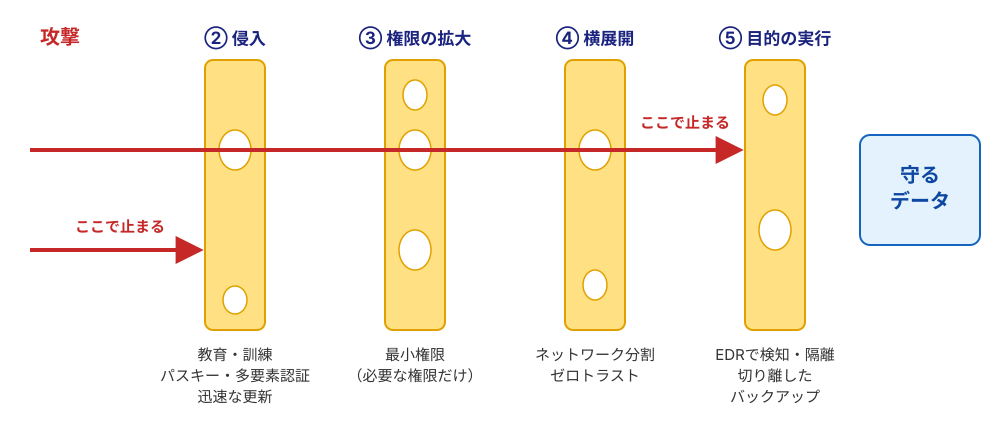

# 情報セキュリティとサイバー脅威

### 本日のアジェンダ

#### 🗺️ 全5テーマ

1. **攻撃の仕組み** —— マルウェア・脆弱性・攻撃の流れ
2. **ソーシャルエンジニアリング** —— 人を狙う攻撃
3. **AIは攻撃をどう変えたか** —— 攻撃が増える理由と、これから
4. **完璧な防御はない** —— 組織はどう守るか
5. **サイバー犯罪と法律**

---

### 到達目標

* 代表的なマルウェアとサイバー攻撃（ゼロデイ攻撃など）の仕組みを説明できる
* ソーシャルエンジニアリングが成功する理由と、仕組みによる対策を説明できる
* AIの進化で攻撃が増える理由と、今後の変化を説明できる
* 完璧な防御が存在しない理由と、組織の守り方（多層防御・ゼロトラスト・インシデント対応）を説明できる
* 不正アクセス禁止法が禁じる行為を理解している

---

### 情報セキュリティの3要素（CIA）

| | 英語 | 日本語 | 意味 | 破られる例 |
|:---:|:---|:---|:---|:---|
| **C** | **C**onfidentiality | 機密性 | 許可された人だけが見られる | 情報漏洩、通信の盗聴 |
| **I** | **I**ntegrity | 完全性 | 改ざんされず正確 | Webページの改ざん、データの書き換え |
| **A** | **A**vailability | 可用性 | 必要なときに使える | ランサムウェア、DDoSによるサービス停止 |

以降、それぞれの攻撃が**CIAのどれを破るのか**に注目していきます。

::: {.callout-note title="⚖️ 利便性とのバランス"}
厳しすぎると使われず、緩すぎると漏れる。この釣り合いがセキュリティの本質です。
:::

---

## 1. 攻撃の仕組み

### マルウェアの種類

「ウイルス」は**マルウェア**（悪意あるプログラム全般）の一種にすぎない。

| 種類 | 特徴 |
|:---|:---|
| ウイルス | 他のファイルに寄生して増殖 |
| ワーム | 単独でネットワーク経由に拡散 |
| トロイの木馬 | 無害なふりをして侵入 |
| スパイウェア | 入力・画面・位置情報を盗み見 |
| インフォスティーラー | 保存したパスワードや**ログイン状態（Cookie）**をまとめて盗む。ログイン状態ごと盗まれると、2段階認証も効かない |
| ボット | 外部から遠隔操作され、DDoS攻撃や迷惑メール送信の「踏み台」にされる |
| ランサムウェア | データを暗号化し身代金を要求 |

---

### サイバー攻撃の種類（1）—— ソフトの弱点を突く {.smaller}

**脆弱性**：ソフトウェアの設計ミスや不具合による、セキュリティ上の弱点（セキュリティホール）。

| 攻撃 | 何をするか | 破るもの | 主な対策 |
|:------|:-----------|:---:|:---------|
| **ゼロデイ攻撃** | 修正プログラムが出る前の脆弱性を突く（修正までの猶予が「0日」） | C・I・A | EDR（後述）で振る舞いを検知、修正が出たら即更新 |
| **バッファオーバーフロー** | 想定より長いデータを送ってメモリをあふれさせ、攻撃者のコードを実行させる | C・I・A | 入力長の検査、OS・アプリの更新 |
| **SQLインジェクション** | 入力欄にデータベースへの命令を混ぜ、情報を盗む・書き換える | C・I | 入力をそのまま命令に使わない（開発側） |
| **XSS**（クロスサイトスクリプティング） | Webページに悪意あるスクリプトを埋め込み、閲覧者のブラウザで実行させる | C・I | 出力時の無害化（開発側） |

* システムを乗っ取る攻撃は、乗っ取った後に何でもできるので**C・I・Aすべて**を破りうる。

::: {.callout-tip title="利用者にできること"}
多くの攻撃は脆弱性を入口にします。利用者にできる最大の防御は、**OS・アプリをすぐ更新すること**です。
:::

---

### サイバー攻撃の種類（2）—— サービス・認証・通信

| 攻撃 | 何をするか | 破るもの | 主な対策 |
|:------|:-----------|:---:|:---------|
| **DDoS攻撃**（Distributed Denial of Service） | 大量の端末から一斉にアクセスし、サービスを停止させる | A | 通信の分散・遮断の仕組み（提供側） |
| **パスワードリスト攻撃** | 他サイトから漏れたID・パスワードを試す | C | 使い回さない、パスキー |
| **中間者攻撃** | 通信の間に割り込み、盗聴・改ざんする | C・I | HTTPSの確認、怪しいフリーWi-Fiを避ける |
| **サプライチェーン攻撃** | 守りの弱い取引先や、使われているソフトを経由して侵入 | C・I・A | 取引先も含めた対策 |

---

### 攻撃はどう進むか —— 侵入から目的達成まで

```{mermaid}
flowchart LR
    A["① 偵察<br/>標的を調べる"] --> B["② 侵入<br/>だまし・脆弱性"]
    B --> C["③ 権限の拡大<br/>管理者になる"]
    C --> D["④ 横展開<br/>社内の他の端末へ"]
    D --> E["⑤ 目的の実行<br/>窃取・暗号化"]
    style E fill:#ffebee,stroke:#c62828
```

* 実際の攻撃は、1つの技術ではなく**複数の手口の組み合わせ**で段階的に進む（サイバーキルチェーン）。
* 侵入から目的の実行まで、**数日〜数週間潜伏**することも多い。
* 裏を返せば、**防御側はどの段階でも止められる**。これが多層防御（第4章）の考え方。

---

### ランサムウェア —— 組織犯罪のビジネス

* **ランサムウェアとは**：データを勝手に暗号化して使えなくし、「元に戻してほしければ払え」と**身代金（ransom）**を要求するマルウェア。
* 標的は個人ではなく**企業・病院・自治体**（止まると損失が大きい＝払わせやすい）。
* **二重恐喝**：暗号化に加え、盗んだ機密を「払わなければ公開」と脅す。暗号化で**A**、漏洩で**C**を同時に破るので、バックアップで復旧しても漏洩の問題は残る。
* 侵入の道具を貸し出す**RaaS**（Ransomware as a Service）もあり、分業化した犯罪ビジネスになっている。

```{mermaid}
flowchart LR
    A[不正侵入] --> B[機密情報を窃取]
    B --> C[全サーバーを暗号化]
    C --> D["💥 業務停止<br/>身代金要求"]
    B --> E["💀 公開で脅迫<br/>二重恐喝"]
    style D fill:#ffebee,stroke:#c62828
    style E fill:#ffebee,stroke:#c62828
```

---

### 【実例】日本でも、生活に直結する被害が続く

| 時期 | 組織 | 影響 |
|:---|:---|:---|
| 2022年3月 | トヨタ（取引先経由） | 国内全14工場が1日停止 |
| 2022年10月 | 大阪急性期・総合医療センター | 電子カルテが使えず、診療再開まで2ヶ月以上 |
| 2024年6月 | KADOKAWA | ニコニコ動画等が停止、情報流出 |
| 2025年9月 | **アサヒグループ** | 受注・出荷が停止、個人情報約190万件が漏洩の可能性 |
| 2025年10月 | **アスクル** | ASKUL・LOHACOの受注が停止 |

* 共通点：**1か所の侵入が、物流・販売・医療まで止める**。
* 攻撃者は**一番弱い入口**を選ぶ。取引先・委託先が入口になることも多く、警察庁の統計ではランサムウェア被害の**約3分の2が中小企業**。

---

## 2. ソーシャルエンジニアリング

### 一番弱いのは人 —— ソーシャルエンジニアリングとは

* 技術ではなく、**人の心理や習慣の隙**を突いて、情報やアクセス権を手に入れる手口。
* 堅いシステムの脆弱性を探すより、**中の人に扉を開けてもらう**ほうが安く速い。
* 古典的な手口：電話で社員や業者になりすます／肩越しに画面を盗み見る（ショルダーハッキング）／捨てた書類をあさる（トラッシング）。

::: {.callout-important title="【実例】米MGMリゾーツ（2023年）"}
攻撃者はSNSで社員を調べ、**ITヘルプデスクに電話して本人になりすまし**、認証情報をリセットさせた。ホテル・カジノのシステムが停止し、損失は約1億ドルと報告された。入口は技術ではなく**1本の電話**だった。
:::

---

### だまされるのは意志が弱いからではない

| 心理の原理 | 攻撃での使われ方 |
|:---|:---|
| **緊急性** | 「24時間以内に対応しないとアカウント停止」 |
| **権威** | 警察・上司・IT部門を名乗る |
| **恐怖** | 「ウイルスに感染しました。今すぐ電話を」 |
| **利得** | 還付金・当選・高収入バイト |
| **好意・信頼** | 乗っ取った友達のアカウントから「投票お願い」 |

* 焦りや恐怖で冷静な思考（システム2）が止まり、反射的に動いてしまう。**誰でもだまされうる**。
* だから「気をつけよう」だけでは防げない。

---

### 現代の手口

| 手口 | 内容 |
|:---|:---|
| **フィッシング** | 偽メール・偽SMSで偽サイトに誘導し、IDやパスワードを入力させる |
| **スピアフィッシング** | 調べ上げた**特定の個人**向けに作り込んだ偽メール |
| **ビジネスメール詐欺**（BEC） | 取引先や経営者を装い、送金先の変更を指示する |
| **ビッシング**（ボイスフィッシング） | 電話で銀行・警察・IT部門を装う |
| **SNS乗っ取りDM** | 「届いた番号を教えて」＝あなたのログイン認証コード |
| **ClickFix**（偽CAPTCHA） | 「ロボットでないことを確認」の画面で `Win+R` → `Ctrl+V` → `Enter` を指示し、攻撃者のコマンドを**自分で実行**させる |

---

### 漏れた情報が、次のだましの材料になる

```{mermaid}
flowchart LR
    A[企業から流出] --> B[氏名・メール・取引先を把握]
    B --> C["本物そっくりの<br/>偽メール・偽電話"]
    C --> D[💥 ID・パスワード・認証コードを窃取]
    style D fill:#ffcdd2,stroke:#d32f2f
```

* 「口座番号」「最近の購入履歴」など**実在の情報を添えた詐欺**は、見抜きにくい。
* 流出は「その企業の問題」で終わらず、**後から別の人に届く攻撃**になる。1社の**C**の破れが、次の攻撃の入口になる。

---

### URLで見分けるのは難しい

`https://` **`login.smbc-card.com`**`.fake-phish.jp` `/app/index.html`

* 本当の所有者は**最初の `/` の直前**のドメイン（ここでは `fake-phish.jp`）。前半は攻撃者が自由に名付けられる。
* ただし、スマホではURLの大部分が隠れ、本物に似た文字を使うドメインもある。**毎回目で見抜くのは現実的でない**。

::: {.callout-tip title="🛡️ だから"}
メール・SMSのリンクからはログインしない。**公式アプリかブックマーク**から開く。
:::

---

### 📱 クイズ：本物のメルカリ（`mercari.com`）はどれ？

1. `https://www.mercari.com.account-update.info/login`
2. `https://mercari.com/jp/`
3. `https://login-mercari-jp.com/`

::: {.notes}
正解は2。1は `account-update.info`、3は `login-mercari-jp.com` という別人のドメイン。
:::

---

### 人の注意に頼らない対策

* 偽サイトが本物とリアルタイムで中継するので、**SMSや認証アプリのコードを入れても乗っ取られる**。
  * 2025年には、こうして盗んだIDで証券口座に入り、**株を勝手に売買する**被害が相次いだ。
* **パスキー**はサイトのドメインと結びついているので、偽サイトでは使えない。**人が見抜けなくても、仕組みが拒否する**（詳しくは「認証と個人のセキュリティ」の回）。
* 組織では、送金先の変更やパスワードのリセットを**別の経路で確認する手順**として決めておく（MGMの教訓）。

::: {.callout-tip title="💡 考え方"}
人を鍛えることも大切だが、**だまされても被害が出ない仕組み**を作るほうが確実。
:::

---

## 3. AIは攻撃をどう変えたか

### なぜAIで攻撃が増えるのか

サイバー攻撃は**コストと見返りのビジネス**。AIは攻撃のコストを大きく下げた。

| | AI以前 | AI以後 |
|:---|:---|:---|
| **参入** | 技術・語学力が必要 | 素人でも文面・偽サイト・マルウェアを作れる |
| **規模** | 一人ひとり向けに作り込むのは手間 | 個人に合わせた偽メールを**大量に自動生成** |
| **速度** | 脆弱性の分析に時間がかかる | 公開から悪用までが**数時間〜数日**に短縮 |
| **自動化** | 人が手作業で侵入 | **AIエージェントが侵入作業を代行** |

* 10代が生成AIでランサムウェアを自作したとして逮捕された例が、日本でも報じられている。
* Anthropicは2025年11月、国家支援とみられるグループが、AIコーディングツールで侵入作業の**大半（同社の推定で80〜90%）を自動化**した事例を公表した（約30組織が標的）。

---

### AIで書き換わった「セキュリティの常識」

| これまでの常識 | 今は |
|:---|:---|
| 不自然な日本語・誤字で偽メールを見抜く | **自然な文面が当たり前**。文面では見抜けない |
| 声や顔を見れば本人と分かる | **声も顔も複製できる**。別の手段で確認 |
| 複雑なパスワードにすれば安全 | 偽サイトで盗まれる。**パスキー**へ |
| 重要な情報がなければ狙われない | **自動化で、誰でも標的になる** |
| 脆弱性は公開後に直せばよい | 公開と同時に悪用が始まる |
| 検索結果・画像・動画は証拠になる | **真偽を疑う**。出どころを確かめる |

---

### 声と顔を偽る —— ディープフェイク

* 数秒の音声から**家族や上司の声を複製**し、電話で送金や認証を迫る。
* **ビデオ会議のディープフェイク**で、経営幹部になりすまして送金させた事例が海外で出ている。
* SNSの「友達」も、生成AIで作られた顔・文章かもしれない。

::: {.callout-important title="🚨 鉄則"}
声や顔は証拠にならない。お金・認証コードの話が出たら、**別の手段（通話・対面）で本人確認**。家族や職場で合言葉や確認手順を決めておくのも有効。
:::

---

### AIそのものが狙われる

* **プロンプトインジェクション**：Webページやメールに**AIへの命令を隠す**攻撃。AIエージェントが情報を外部に送ったり、勝手に操作したりする恐れ（2026年に研究者の実証が相次ぎ、実際の攻撃も出始めた）。
* **シャドーAI**：許可されていないAIに、機密や個人情報を貼り付けてしまう。
  * 「入力が学習され、他人への回答に出てくる」形の漏洩は、**実際にはほとんど確認されていない**。起きているのは、共有リンクが検索結果に載る、サービス側の不具合など、普通のクラウドと同じ種類の事故。
  * 組織が禁止するのは、**契約や管理の外にデータを出すこと自体**が問題だから。
* **AIの出力を信じすぎる**：もっともらしい誤りを含む。重要な判断やコードは**必ず確認**する。

::: {.callout-tip title="🛡️ 基本ルール"}
①機密は許可されたAIにだけ ②出力は確認 ③AIに広い権限を渡さない ④AIが読む外部の文章には命令が隠れうる
:::

---

### これからどうなるか

* **AI対AI**：攻撃の自動化が進む一方、防御側もAIで脆弱性を探し、大量の警告を分析する。GoogleのAIが、実際に使われているソフトの未知の脆弱性を見つけた例も出ている。
* **「本物の証明」が重要になる**：文面・声・映像が信用できなくなるので、パスキー・電子署名・コンテンツの来歴証明（C2PA）など、**暗号技術で本物を示す**方向へ。
* **量子コンピュータへの備え**：将来、今の公開鍵暗号が破られる恐れがあるため、**耐量子暗号**への移行が始まっている（米NISTが2024年に標準化）。今盗んだ暗号文を将来解読する「Harvest now, decrypt later」も懸念されている。
* **国家の関与**：サイバー攻撃は安全保障の問題に。日本も2025年に、攻撃の兆候をつかみ、攻撃元に対処する**能動的サイバー防御**の法律を整備した。

---

## 4. 完璧な防御はない

### なぜ完璧な防御はあり得ないのか

* **攻撃と防御の非対称性**：防御側はすべての入口を毎日守らなければならないが、攻撃者は**1か所を1回**破ればよい。
* **脆弱性はなくならない**：OSは数千万行のコードでできている。使っているライブラリや委託先まで含めると、全体を把握しきれない。
* **人は必ずミスをする**：訓練しても、だまされる人はゼロにならない。
* **コストと利便性**：守りを固めるほど高く、不便になる。厳しすぎるルールは、こっそり回避される（シャドーIT）。

::: {.callout-note title="💡 だから目標を変える"}
「絶対に侵入されない」ではなく、**侵入されても被害を小さくし、早く元に戻す**。
:::

---

### セキュリティはリスク管理

* **リスク ＝ 起こる可能性 × 起きたときの影響**。ゼロにはできないので、**優先順位**をつける。
* リスクへの対応は4つ：**低減**（対策する）・**回避**（その業務をやめる）・**移転**（保険・外部委託）・**受容**（受け入れる）。
* **守る対象を知る**：持っている機器・ソフト・データを把握していなければ、守りようがない（資産管理）。
* セキュリティはIT部門だけでなく**経営の問題**。止まったときの損失、取引先への影響、信用の失墜は経営判断の対象（経済産業省「サイバーセキュリティ経営ガイドライン」）。

---

### 多層防御 —— 穴の位置が違う層を重ねる

1つの対策には必ず穴がある。**複数の層を重ねて**、すべてを貫通されないようにする（スイスチーズモデル）。

{fig-align="center" width="85%"}

* 層の見出しは、第1章「攻撃はどう進むか」の段階に対応している。

---

### 境界型防御の崩壊 → ゼロトラスト

* **従来**：ファイアウォール／VPN（Virtual Private Network：インターネット上に仮想の専用線を作る仕組み）で城壁を築き、内側を無条件に信用。
* **崩壊の理由**：クラウド・テレワークで境界が消えた。VPN機器の脆弱性や盗まれた認証情報で突破されると、内部は**やりたい放題**。
* **ゼロトラスト（Never Trust, Always Verify）**：場所に関係なく、**アクセスごとに**「誰か・端末は健全か・不審な挙動はないか」を確認する。

::: {.callout-tip title="✈️ 空港でたとえると"}
入口で1回確認すれば乗り放題が「境界型」。搭乗口でも座席でも毎回パスポートを確認するのが「ゼロトラスト」。
:::

---

### EDR —— PCの「ドラレコ兼緊急ブレーキ」

* **EDR**（**E**ndpoint **D**etection and **R**esponse）：エンドポイント（PC・スマホ・サーバーなど、ネットワークの末端の端末）で、侵入を**検知**し**対応**する仕組み。
* **EPP**（**E**ndpoint **P**rotection **P**latform）：従来のウイルス対策ソフト。

| 項目 | EPP | EDR |
|:---|:---|:---|
| 思想 | 侵入を水際で防ぐ | **侵入を前提**に検知・隔離 |
| 判定 | 既知のパターン | 不審な**振る舞い** |
| 未知の脅威 | すり抜けやすい | 異常挙動で遮断 |
| 事後調査 | 追跡が困難 | 侵入経路を再現 |

* 暗号化などの怪しい動きを見つけたら、**自動でPCをネットワークから隔離**する。
* 近年は、EDRを止めようとする攻撃も増えている。**EDRを入れて安心せず、更新と運用も必要**。

---

### 起きたときにどう動くか —— インシデント対応

* **検知 → 封じ込め → 根絶 → 復旧 → 振り返り**の流れを、事前に決めて訓練しておく。
* 専門チーム **CSIRT**（Computer Security Incident Response Team）を置き、連絡先と判断する人を決めておく。
* **ログを残す**：何が起きたか追えなければ、原因も被害の範囲も分からない。
* **隠さず報告・公表する**：個人情報の漏洩は、個人情報保護委員会への報告と本人への通知が義務。

---

### 身代金は払わない —— 復旧の生命線はバックアップ

**払ってはいけない理由**：鍵が戻る保証はない／「払う相手」として再攻撃される／犯罪組織の資金になる。

* 攻撃者は暗号化の前に、**まずバックアップを探して壊す**。
* 自力で復旧できるのは、**ネットワークから切り離した、または書き換えできない**バックアップを持つ組織。
* 定番の考え方は**3-2-1ルール**：コピーを3つ、媒体を2種類、1つは離れた場所に。
* ただし、バックアップが守るのは**A**だけ。盗まれた情報（**C**）は戻らないので、暗号化やデータを持たないことと組み合わせる。

---

### 自社だけでは守れない —— 委託先とサプライチェーン

* **情報が一か所に集まりすぎ**：会員・アプリ・ポイントで、氏名・連絡先・購入履歴が大量に蓄積される。
* **委託先・SaaSに預けている**：問い合わせ管理、クラウド、アプリ開発などを外部に任せている。
  * 2026年秋は、同じ問い合わせ管理システムの提供元が破られ、大和証券・シチズン・損保ジャパンなど複数社が同時に影響を受けた。
  * 第一興商は、委託先の従業員PCのマルウェア感染が発端とされる。
* **持ち続ける情報が多い**：退会者のデータや運転免許証の画像が、通常の会員DBと同じ場所に残っていた例がある。持たないデータは漏れない。

::: {.callout-note title="📊 数字で見ると"}
MM総研の集計では、サイバー攻撃による情報流出の公表は2026年1〜9月で454件、前年同期比で約49%増。ただし、件数は公表数であり、**増えたのは攻撃だけでなく、公表の増加**もあり得る。
:::

---

## 5. サイバー犯罪と法律

### 不正アクセス禁止法 —— 3つの処罰行為

「パスワードを知っていた」「ふざけただけ」でも、権限のないログインは**犯罪**です。

| 行為 | 罪名 | 法定刑 |
|:---|:---|:---|
| 勝手にログイン | 不正アクセス行為（第3条） | 3年以下の拘禁刑／100万円以下の罰金 |
| 他人のIDを不正に取得 | 不正取得（第4条） | 1年以下の拘禁刑／50万円以下の罰金 |
| 他人にパスワードを教える | 不正アクセスの助長（第5条） | 1年以下の拘禁刑／50万円以下の罰金 |

* 偽サイトでIDの入力を促すフィッシング行為そのものも、処罰の対象（第7条）。
* 盗んだIDで**証券口座に不正アクセス**すれば、不正アクセス禁止法違反に加え、**詐欺罪**などが問われる。
* 闇バイトで口座やSIMを売り渡すのも**犯罪収益移転防止法違反**。

---

### まとめ

1. **攻撃は組み合わせ**：脆弱性・マルウェア・だましをつなげて、段階的に侵入する。何を破るかは**CIA**で整理できる。
2. **一番弱いのは人**：心理の隙を突く攻撃は、注意だけでは防げない。パスキーや確認手順など**仕組みで守る**。
3. **AIは攻撃のコストを下げた**：攻撃は増え、速く、自然になる。文面・声・顔は証拠にならない。
4. **完璧な防御はない**：侵入を前提に、多層防御・ゼロトラスト・EDR・インシデント対応・バックアップで、**被害を小さく、早く戻す**。
5. **個人の基本**：OS・アプリをすぐ更新する。リンクからログインしない。指示されたコマンドを実行しない。機密をAIに入れない。
6. **法を守る**：他人のアカウントにログインしない。

::: {.callout-tip title="🎓 脅威を知ることが最強の盾"}
サイバー攻撃は遠い世界の話ではなく、あなたのアカウントやPCを「踏み台」にして広がります。
:::
