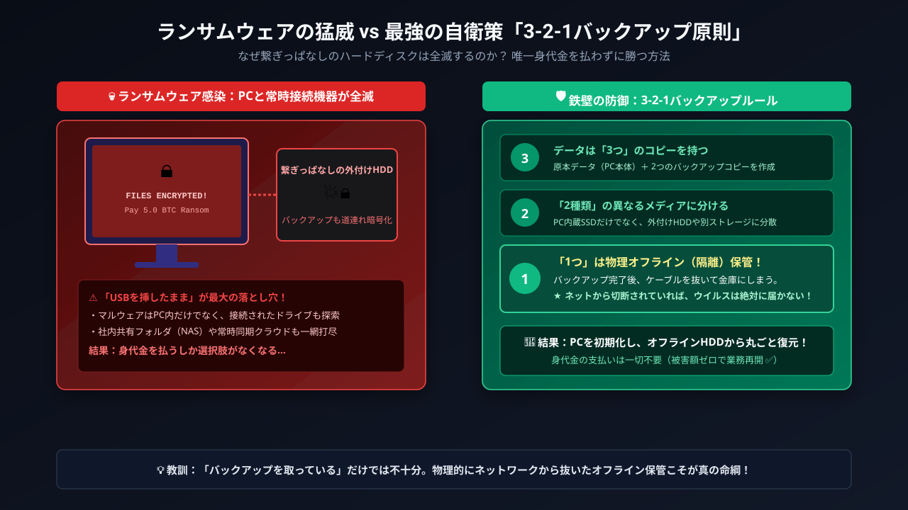

# 情報セキュリティとサイバー脅威

### 本日のアジェンダ

#### 🗺️ 全6テーマ

1. **画面の裏の罠** —— 偽URL・野良アプリ
2. **AI時代の詐欺** —— フィッシング・なりすまし・闇バイト
3. **マルウェアとサイバー攻撃** —— 攻撃の種類・ランサムウェア・情報漏洩
4. **組織を守る新しい考え方** —— ゼロトラスト・EDR・AI利用のリスク
5. **筒抜けの行動** —— 追跡・位置情報
6. **サイバー犯罪と法律** —— 不正アクセス禁止法

---

### 到達目標

* 偽URL・野良アプリ・フィッシングを見抜き、適切に対処できる
* AIで変わった攻撃の常識と、AI利用の新しいリスクを説明できる
* 代表的なマルウェアとサイバー攻撃（ゼロデイ攻撃など）の仕組みを説明できる
* ランサムウェアの手口と3-2-1バックアップを説明できる
* 追跡・位置情報のリスクを知り、設定で自衛できる
* 不正アクセス禁止法が禁じる行為を理解している

---

### 情報セキュリティの3要素（CIA）

| | 英語 | 日本語 | 意味 | 破られる例 |
|:---:|:---|:---|:---|:---|
| **C** | **C**onfidentiality | 機密性 | 許可された人だけが見られる | 情報漏洩、通信の盗聴 |
| **I** | **I**ntegrity | 完全性 | 改ざんされず正確 | Webページの改ざん、データの書き換え |
| **A** | **A**vailability | 可用性 | 必要なときに使える | ランサムウェア、DDoSによるサービス停止 |

::: {.callout-note title="⚖️ 利便性とのバランス"}
厳しすぎると使われず、緩すぎると漏れる。この釣り合いがセキュリティの本質です。
:::

---

## 1. 画面の裏の罠

### 偽URLと野良アプリ

**URLは「最初の / の直前」を見る**

`https://` **`login.smbc-card.com`**`.fake-phish.jp` `/app/index.html`

* 本当の所有者は `/` の直前のドメイン（ここでは `fake-phish.jp`）。前半のサブドメインは、攻撃者が自由に名付けられる。
* 例：`apple.com.secure-auth.net` は apple.com ではない。不安ならリンクを踏まず、公式アプリやブックマークから開く。

**野良アプリと「構成プロファイル」**

* 公式ストア外の「MODアプリ」は、情報窃盗マルウェアの温床。
* iPhoneで「プロファイルをインストール」を許可すると、**全通信を犯人のサーバー経由にされる**恐れがある。
* 怪しいサイトの「カレンダーを照会しますか？」を許可すると、「ウイルス検出！」が毎日届く（本体は無事。設定→カレンダー→アカウントから削除）。

---

### 📱 クイズ：本物のメルカリ（`mercari.com`）はどれ？

1. `https://www.mercari.com.account-update.info/login`
2. `https://mercari.com/jp/`
3. `https://login-mercari-jp.com/`

::: {.notes}
正解は2。1は `account-update.info`、3は `login-mercari-jp.com` という別人のドメイン。
:::

---

## 2. AI時代の詐欺

### AIで「攻撃のハードル」が下がった

* 以前は、攻撃には**技術・語学力・手間**が必要で、それが防御側の手がかりにもなっていた。
* 今は、生成AIで**文面・偽サイト・マルウェアを、素人でも作れる**。
  * 10代が生成AIでランサムウェアを自作したとして逮捕された例が、日本でも報じられている。
* さらにAIが**攻撃の作業そのものを代行**し始めた。Anthropicは2025年11月、国家支援とみられるグループが、AIコーディングツールで侵入作業の**大半（同社の推定で80〜90%）を自動化**した事例を公表した（約30組織が標的）。
* 結果：**攻撃者の数が増え、攻撃が速く、安く、自然になる**。

---

### AIで書き換わった「セキュリティの常識」

| これまでの常識 | 今は |
|:---|:---|
| 不自然な日本語・誤字で偽メールを見抜く | **自然な文面が当たり前**。文面では見抜けない |
| 声や顔を見れば本人と分かる | **声も顔も複製できる**。別の手段で確認 |
| 複雑なパスワードにすれば安全 | 偽サイトで盗まれる。**パスキー**へ |
| 重要な情報がなければ狙われない | **自動化で、誰でも標的になる** |
| 脆弱性は公開後に直せばよい | 公開から悪用までが**数時間〜数日**に短縮 |
| 検索結果・画像・動画は証拠になる | **真偽を疑う**。出どころを確かめる |

---

### フィッシングの被害 —— 銀行から証券口座へ

* 警察庁によると、ネットバンキングの不正送金の**約9割がフィッシング**由来（2025年：約4,700件・約100億円）。
* 偽サイトは**宅配・銀行・クレカ・証券・行政**を装う。
* **2025年の衝撃**：盗んだID・パスワードで証券口座にログインし、**保有株を勝手に売却して別の銘柄を買い付ける**（株価をつり上げて利益を得る）。
  * 初めの4か月だけで、不正取引は約3,500件、売買額は1,000億円超と報告された。

---

### 認証コードも盗まれる —— 本命の対策はパスキー

* 偽サイトが本物とリアルタイムで中継するため、**SMSや認証アプリのコードを入れても乗っ取られる**（詳しくは「認証と個人のセキュリティ」の回）。
* 電話で「口座が不正利用された」と誘導する**ボイスフィッシング**と組み合わされることも多い。
* **パスキー**はサイトのドメインと結びついているので、偽サイトでは使えない。

::: {.callout-tip title="🛡️ 今日からできる3つ"}
1. 重要なアカウントを**パスキー**にする
2. 使い回しをやめ、**パスワードマネージャー**を使う
3. メール・SMSのリンクは踏まず、**公式アプリから**開く
:::

---

### AIが変えた詐欺 —— 声と顔を偽る

* 数秒の音声から**家族や上司の声を複製**し、電話で送金や認証を迫る。
* **ビデオ会議のディープフェイク**で、経営幹部になりすまして送金させた事例が海外で出ている。
* SNSの「友達」「恋人」も、生成AIで作られた顔・文章かもしれない。

::: {.callout-important title="🚨 鉄則"}
声や顔は証拠にならない。お金・認証コードの話が出たら、**別の手段（通話・対面）で本人確認**。家族間で合言葉を決めておくのも有効。
:::

---

### SNSを入口にした詐欺

:::: {.columns}
::: {.column width="50%"}
**乗っ取り：「投票お願い」DM**

* 友達のアカウントは既に乗っ取られている。
* 「届いた4桁の番号を教えて」＝**あなたのログイン認証コード**。
* 教えた瞬間にあなたも乗っ取られ、次の「踏み台」にされる。
:::
::: {.column width="50%"}
**SNS型投資・ロマンス詐欺**

* 数ヶ月かけて親密になり、偽の取引アプリへ誘導。
* 少額は出金できて信用させ、大金を入れた途端に出金不能・音信不通。
* 2025年の被害額は**約1,800億円**と過去最多（警察庁）。
:::
::::

::: {.callout-important title="🚨 鉄則"}
認証コードは誰にも教えない。SNSで知り合った相手の投資話は、例外なく詐欺。
:::

---

### 闇バイト・口座売買

* 「荷物を受け取るだけ」「口座を作って渡すだけ」＝特殊詐欺の受け子・出し子。
* 応募時に送った身分証を握られ、辞めようとすると家族を脅される。
* 口座売買は**犯罪収益移転防止法違反**。逮捕されるのは末端の実行犯。
* 口座凍結で**給与口座すら作れなくなる**。

```{mermaid}
flowchart LR
    A[即日高収入に応募] --> B[身分証を送らされ脅迫材料に]
    B --> C[受け子・口座譲渡]
    C --> D[逮捕]
    D --> E[💥 口座凍結・社会的信用の喪失]
    style E fill:#ffcdd2,stroke:#d32f2f
```

---

### だまされるのは意志が弱いからではない

* 詐欺は4つの感情を突く：**緊急**（24時間以内）・**恐怖**（凍結）・**権威**（警察・国税）・**利得**（還付）。
* 焦りや恐怖で、冷静な思考（システム2）が止まり、反射的に押してしまう。
* **対策は「一呼吸おく」**。急がせる連絡ほど疑う。

---

## 3. マルウェアとサイバー攻撃

### マルウェアの種類

「ウイルス」は**マルウェア**（悪意あるプログラム全般）の一種にすぎない。

| 種類 | 特徴 |
|:---|:---|
| ウイルス | 他のファイルに寄生して増殖 |
| ワーム | 単独でネットワーク経由に拡散 |
| トロイの木馬 | 無害なふりをして侵入 |
| スパイウェア | 入力・画面・位置情報を盗み見 |
| インフォスティーラー | ブラウザに保存したパスワードやログイン状態をまとめて盗む |
| ボット | 外部から遠隔操作され、DDoS攻撃や迷惑メール送信の「踏み台」にされる |
| ランサムウェア | データを暗号化し身代金を要求 |

---

### サイバー攻撃の種類（1）—— ソフトの弱点を突く {.smaller}

**脆弱性**：ソフトウェアの設計ミスや不具合による、セキュリティ上の弱点（セキュリティホール）。

| 攻撃 | 何をするか | 主な対策 |
|:---|:---|:---|
| **ゼロデイ攻撃** | 修正プログラムが出る前の脆弱性を突く（修正までの猶予が「0日」） | EDR（後述）で振る舞いを検知、修正が出たら即更新 |
| **バッファオーバーフロー** | 想定より長いデータを送ってメモリをあふれさせ、攻撃者のコードを実行させる | 入力長の検査、OS・アプリの更新 |
| **SQLインジェクション** | 入力欄にデータベースへの命令を混ぜ、情報を盗む・書き換える | 入力をそのまま命令に使わない（開発側） |
| **XSS**（クロスサイトスクリプティング） | Webページに悪意あるスクリプトを埋め込み、閲覧者のブラウザで実行させる | 出力時の無害化（開発側） |

::: {.callout-tip title="利用者にできること"}
多くの攻撃は脆弱性を入口にします。利用者にできる最大の防御は、**OS・アプリをすぐ更新すること**です。
:::

---

### サイバー攻撃の種類（2）—— サービス・認証・通信

| 攻撃 | 何をするか | 主な対策 |
|:---|:---|:---|
| **DDoS攻撃**（Distributed Denial of Service） | 大量の端末から一斉にアクセスし、サービスを停止させる | 通信の分散・遮断の仕組み（提供側） |
| **パスワードリスト攻撃** | 他サイトから漏れたID・パスワードを試す | 使い回さない、パスキー |
| **中間者攻撃** | 通信の間に割り込み、盗聴・改ざんする | HTTPSの確認、怪しいフリーWi-Fiを避ける |
| **サプライチェーン攻撃** | 守りの弱い取引先や、使われているソフトを経由して侵入 | 取引先も含めた対策 |

---

### ランサムウェア —— 組織犯罪のビジネス

* **ランサムウェアとは**：データを勝手に暗号化して使えなくし、「元に戻してほしければ払え」と**身代金（ransom）**を要求するマルウェア。
* 標的は個人ではなく**企業・病院・自治体**（止まると損失が大きい＝払わせやすい）。
* **二重恐喝**：暗号化に加え、盗んだ機密を「払わなければ公開」と脅す。バックアップで復旧しても、漏洩の問題は残る。

```{mermaid}
flowchart LR
    A[不正侵入] --> B[機密情報を窃取]
    B --> C[全サーバーを暗号化]
    C --> D["💥 業務停止<br/>身代金要求"]
    B --> E["💀 公開で脅迫<br/>二重恐喝"]
    style D fill:#ffebee,stroke:#c62828
    style E fill:#ffebee,stroke:#c62828
```

---

### 【実例】日本でも、生活に直結する被害が続く

| 時期 | 組織 | 影響 |
|:---|:---|:---|
| 2022年3月 | トヨタ（取引先経由） | 国内全14工場が1日停止 |
| 2022年10月 | 大阪急性期・総合医療センター | 電子カルテが使えず、診療再開まで2ヶ月以上 |
| 2024年6月 | KADOKAWA | ニコニコ動画等が停止、情報流出 |
| 2025年9月 | **アサヒグループ** | 受注・出荷が停止、個人情報約190万件が漏洩の可能性 |
| 2025年10月 | **アスクル** | ASKUL・LOHACOの受注が停止 |

* 共通点：**1か所の侵入が、物流・販売・医療まで止める**。
* 自社だけでなく**取引先・委託先**が入口になることも多い。

---

### 「自分は狙われない」は誤解

* 攻撃者は、堅い本丸でなく**一番弱い入口**から入る：新入社員・インターン、取引先の中小企業、委託業者。
* 警察庁の統計では、ランサムウェア被害の**約3分の2が中小企業**。
* 個人のPCも、ボットに感染すれば攻撃者に操られ（ボットネット）、DDoS攻撃などの犯罪に使われる。

---

### 身代金は払わない・バックアップで備える

**払ってはいけない理由**：鍵が戻る保証はない／「払う相手」として再攻撃される／犯罪組織の資金になる。

**3-2-1バックアップ**

* **3**つのコピー（原本＋バックアップ2つ）
* **2**種類の媒体（内蔵SSD＋外付けHDD／NASなど）
* **1**つは遠隔・オフライン（クラウド、または**繋ぎっぱなしにしない**外付けドライブ）

{fig-align="center" width="55%"}

::: {.callout-tip title="個人のデータも同じ"}
レポート・研究データ・写真も、3-2-1で守る。
:::

---

### なぜ個人情報は漏れ続けるのか

* **情報が一か所に集まりすぎ**：会員・アプリ・ポイントで、氏名・連絡先・購入履歴が大量に蓄積される。
* **自社だけで守れない**：問い合わせ管理、クラウド、アプリ開発などを**委託先・SaaS**に預けている。
  * 2026年秋は、同じ問い合わせ管理システムの提供元が破られ、大和証券・シチズン・損保ジャパンなど複数社が同時に影響を受けた。
  * 第一興商は、委託先の従業員PCのマルウェア感染が発端とされる。
* **持ち続ける情報が多い**：退会者のデータや運転免許証の画像が、通常の会員DBと同じ場所に残っていた例がある。

::: {.callout-note title="📊 数字で見ると"}
MM総研の集計では、サイバー攻撃による情報流出の公表は2026年1〜9月で454件、前年同期比で約49%増。ただし、件数は公表数であり、**増えたのは攻撃だけでなく、公表の増加**もあり得る。
:::

---

### どの情報が漏れると危ない？

| 情報 | 危険度 | 変えられるか |
|:---|:---:|:---:|
| パスワード（平文） | ◎ すぐ乗っ取られる | ◯ 変更 |
| ハッシュ化パスワード | △〜◯ 保存方法と長さ次第 | ◯ 変更 |
| カード番号＋セキュリティコード | ◎ ネットで不正利用 | ◯ 再発行 |
| 免許証・マイナンバーカードの画像 | ◯ 身分証として悪用 | ✕ |
| マイナンバー（番号だけ） | △ 番号だけでは手続きできない | ✕ |
| 住所・電話番号・誕生日 | △ 単独では軽い | ✕ |

* **すぐ危ないのは認証に使う情報**。ただし、変えれば無効にできる。
* **長く危ないのは変えられない情報**。組み合わさると「本人そっくり」になり、なりすましや詐欺の材料になる。

---

### 漏れた情報は、次のフィッシングの材料になる

```{mermaid}
flowchart LR
    A[企業から流出] --> B[氏名・メール・取引先を把握]
    B --> C["本物そっくりの<br/>偽メール・偽SMS"]
    C --> D[💥 ID・パスワード・認証コードを窃取]
    style D fill:#ffcdd2,stroke:#d32f2f
```

* 「大和証券の口座番号」など**実在の情報を添えた詐欺**は、見抜きにくい。
* 流出は「その企業の問題」で終わらず、**後から自分に届く詐欺**になる。

::: {.callout-tip title="🛡️ 漏えい通知を受けたら"}
1. 通知メール内のリンクを踏まず、**公式サイト・公式アプリ**で事実を確認
2. パスワード変更などは、「認証と個人のセキュリティ」の回の**「漏らしたかも」と思ったら**の手順で
3. その後の不審な連絡（SMS・電話・請求）を警戒
:::

---

## 4. 組織を守る新しい考え方

### 境界型防御の崩壊 → ゼロトラスト

* **従来**：ファイアウォール／VPN（Virtual Private Network：インターネット上に仮想の専用線を作る仕組み）で城壁を築き、内側を無条件に信用。
* **崩壊の理由**：クラウド・テレワークで境界が消えた。VPN機器の脆弱性や盗まれた認証情報で突破されると、内部は**やりたい放題**。
* **ゼロトラスト（Never Trust, Always Verify）**：場所に関係なく、**アクセスごとに**「誰か・端末は健全か・不審な挙動はないか」を確認する。

::: {.callout-tip title="✈️ 空港でたとえると"}
入口で1回確認すれば乗り放題が「境界型」。搭乗口でも座席でも毎回パスポートを確認するのが「ゼロトラスト」。
:::

---

### EDR —— PCの「ドラレコ兼緊急ブレーキ」

* **EDR**（**E**ndpoint **D**etection and **R**esponse）：エンドポイント（PC・スマホ・サーバーなど、ネットワークの末端の端末）で、侵入を**検知**し**対応**する仕組み。
* **EPP**（**E**ndpoint **P**rotection **P**latform）：従来のウイルス対策ソフト。

| 項目 | EPP | EDR |
|:---|:---|:---|
| 思想 | 侵入を水際で防ぐ | **侵入を前提**に検知・隔離 |
| 判定 | 既知のパターン | 不審な**振る舞い** |
| 未知の脅威 | すり抜けやすい | 異常挙動で遮断 |
| 事後調査 | 追跡が困難 | 侵入経路を再現 |

* 暗号化などの怪しい動きを見つけたら、**自動でPCをネットワークから隔離**する。
* 近年は、EDRを止めようとする攻撃も増えている。**EDRを入れて安心せず、更新と運用も必要**。

---

### 利用者の基本動作

1. **OS・アプリを即アップデート**（自動更新ON）。サポートが終わったOS（Windows 10は2025年10月に終了）は使い続けない。
2. **共用PCでは必ずログアウト**し、ブラウザにパスワードを保存しない。
3. **共有リンクの公開範囲を確認**：「リンクを知っている全員」設定のままだと、資料や名簿が誰でも見られる。
4. **データを1か所だけに置かない**：USBメモリやPC1台だけでは、紛失・故障で失う（3-2-1）。
5. **画面共有の事故を防ぐ**：ウィンドウ指定で共有／集中モードで通知オフ。

---

### AIを使うときの新しいリスク

* **シャドーAI**：許可されていないAIに、機密や個人情報を貼り付けてしまう。
  * 「入力が学習され、他人への回答に出てくる」形の漏洩は、**実際にはほとんど確認されていない**。
  * 起きているのは、**共有リンクが検索結果に載る**、**サービス側の不具合**など、普通のクラウドサービスと同じ種類の事故。
  * 組織が禁止するのは、漏洩の確率より、**契約や管理の外にデータを出すこと自体**が問題だから。
* **AIの出力を信じすぎる**：もっともらしい誤りを含む。重要な判断やコードは**必ず確認**する。
* **プロンプトインジェクション**：Webページやメールに**AIへの命令を隠す**攻撃。AIエージェントが情報を外部に送ったり、勝手に操作したりする恐れ（2026年に研究者の実証が相次ぎ、実際の攻撃も出始めた）。

::: {.callout-tip title="🛡️ 基本ルール"}
①機密・個人情報は、許可されたAIにだけ入力 ②出力は確認 ③AIに広い権限を渡さない ④AIが外部の文章を読むときは、そこに命令が隠れうると考える
:::

---

## 5. 筒抜けの行動

### シークレットモードの誤解

* **隠せるもの**：手元の端末の閲覧履歴・Cookie・入力内容。
* **隠せないもの**：学校・会社のネットワーク管理者、プロバイダ、アクセス先サイトから見た通信。

::: {.callout-tip title="👣 たとえ話"}
部屋の足跡は掃除できても、外の道を歩く姿は防犯カメラ（学校Wi-Fiやアクセス先）に映ったままです。
:::

---

### 写真の位置情報（Exif）

* スマホ写真には緯度・経度・撮影日時が埋め込まれている。
* SNSは多くが自動で消すが、**メール添付・AirDrop・フリマ出品では残る**。

**自衛**：①カメラの位置情報をOFF ②投稿は帰宅後に

---

### 不審なスマートタグ（AirTagなど）

* カバンや車に忍ばされると、居場所がリアルタイムで追跡される。
* iPhone・Androidとも、**一緒に移動する不明タグを自動警告**（Apple・Google共同規格）。
* 警告が出たら音を鳴らして探し、電池を抜く。
* 確認：iPhone「設定→プライバシーとセキュリティ→位置情報サービス→システムサービス」／Android「不明なトラッカーのアラート」。

---

### 「靴の広告が追いかけてくる」怪談 —— リターゲティング広告

* 靴の通販サイトAを見た後、ニュースサイトBに靴の広告が出る。スマホが盗聴されているわけではない。
* 両サイトが同じ広告会社と提携し、**端末のIDで「この人は靴に興味あり」と紐付けている**。

```{mermaid}
sequenceDiagram
    autonumber
    participant U as "ブラウザ"
    participant A as "靴の通販サイトA"
    participant AD as "広告会社"
    participant B as "ニュースサイトB"
    U->>A: 靴のページを閲覧
    AD-->>U: 追跡用Cookieを付与
    U->>B: 別のニュースサイトを閲覧
    B->>AD: 広告枠をリクエスト
    AD->>B: Cookieを照合し「さっきの靴」を表示👟
```

---

### 2026年の現状 —— Cookie規制と、追跡の「引っ越し」

* **Safari・Firefox**：サードパーティCookieを標準でブロック。
* **Chrome**：廃止計画を撤回（2025年）。**今も従来型の追跡が動く**（設定でブロックは可能）。
* **iOS**：ATT（アプリの追跡に許可が必要）で大幅に減少。
* そのため手口は**Cookie以外へ移動**している：

| 新しい手口 | 仕組み |
|:---|:---|
| ログイン情報 | 同じアカウントで端末をまたいで識別 |
| サーバー間連携 | 店のサーバーから広告会社へ直接送信（ブラウザのブロックが効かない） |

---

### 自衛と規制

* **同意バナー**は「必要最低限のみ」を選ぶ。
* **広告IDのリセット／パーソナライズ停止**（iOS・Androidの設定、Google・Metaの広告設定）。
* 位置情報は「**使用中のみ**」、写真は「**選択した写真のみ**」。電卓アプリが位置情報を求めたら疑う。
* **法規制**：日本は2023年施行の改正電気通信事業法（外部送信規律）で、利用者情報の外部送信を通知・公表することを義務付け。EUはGDPRで同意を厳格化。
* 無料サービスの対価は、**あなたの行動データ**。

---

## 6. サイバー犯罪と法律

### 不正アクセス禁止法 —— 3つの処罰行為

「パスワードを知っていた」「ふざけただけ」でも、権限のないログインは**犯罪**です。

| 行為 | 罪名 | 法定刑 |
|:---|:---|:---|
| 勝手にログイン | 不正アクセス行為（第3条） | 3年以下の拘禁刑／100万円以下の罰金 |
| 他人のIDを不正に取得 | 不正取得（第4条） | 1年以下の拘禁刑／50万円以下の罰金 |
| 他人にパスワードを教える | 不正アクセスの助長（第5条） | 1年以下の拘禁刑／50万円以下の罰金 |

* 偽サイトでIDの入力を促すフィッシング行為そのものも、処罰の対象（第7条）。
* 盗んだIDで**証券口座に不正アクセス**すれば、不正アクセス禁止法違反に加え、**詐欺罪**などが問われる。

---

### まとめ —— 6原則

1. **画面の見た目を疑う**：URLと野良アプリを確認する。「ウイルスに感染しました。今すぐ電話を！」という全画面の警告（サポート詐欺）は偽物。電話せず、タブを閉じる。
2. **急がせる連絡ほど疑う**：AIで自然になった偽メール、声や顔の偽装、闇バイトに注意。文面や声は証拠にならない。
3. **だまされにくい認証へ**：パスキーとパスワードマネージャーを使う。
4. **脆弱性をふさぎ、侵入を前提に備える**：OS・アプリの即更新、ゼロトラスト、EDR、3-2-1バックアップ。
5. **AIを正しく使う**：機密を入力しない、出力を確認する、権限を渡しすぎない。
6. **追跡の自衛と法の理解**：位置情報・広告IDを管理し、他人のアカウントには絶対にログインしない。

::: {.callout-tip title="🎓 脅威を知ることが最強の盾"}
サイバー攻撃は遠い世界の話ではなく、あなたのアカウントやPCを「踏み台」にして広がります。
:::
